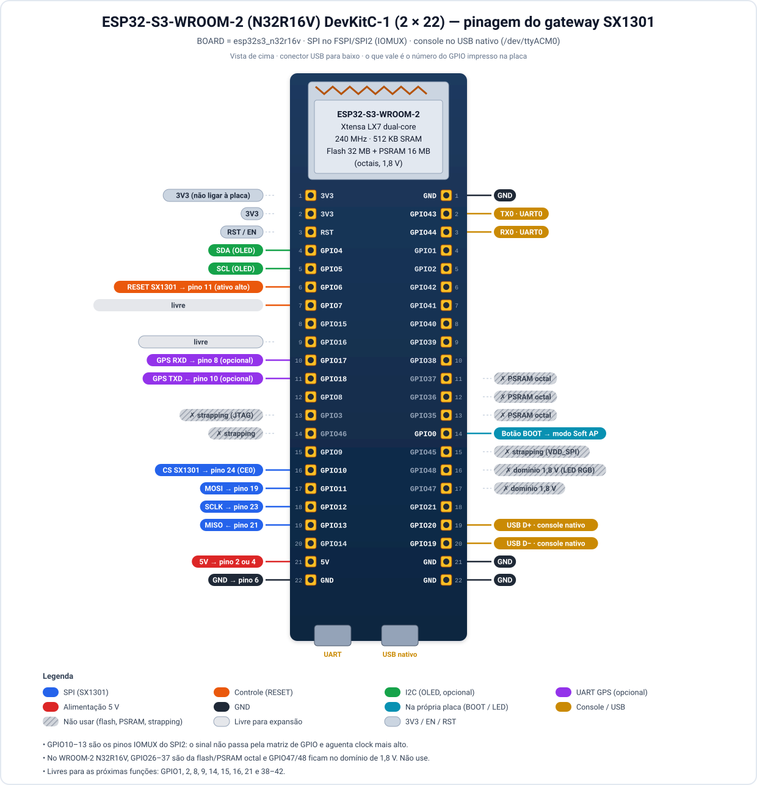
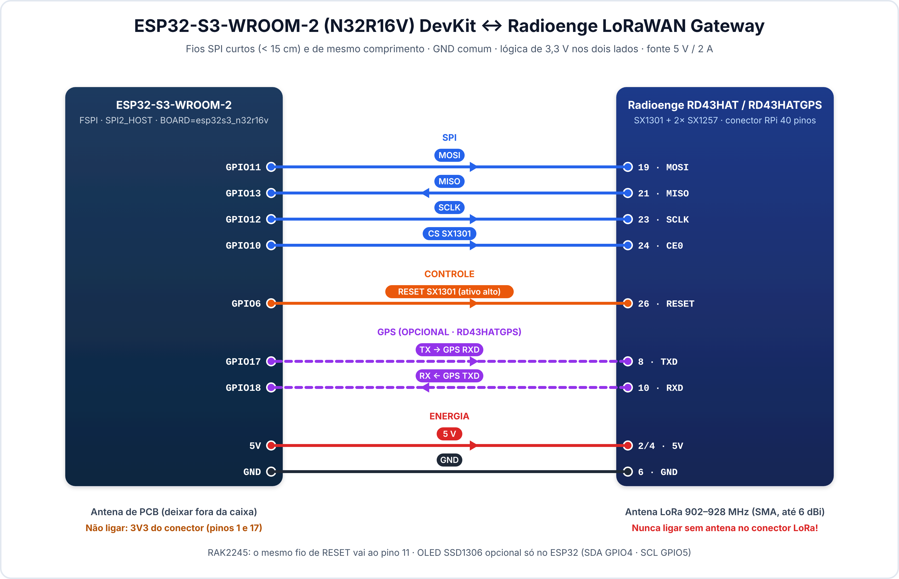
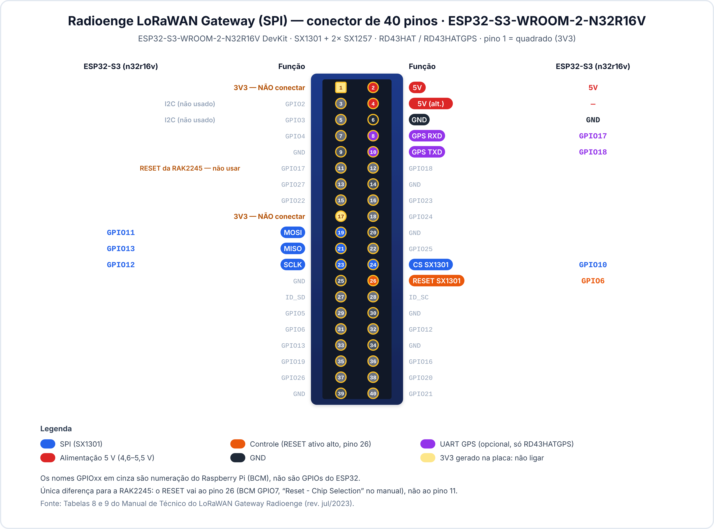
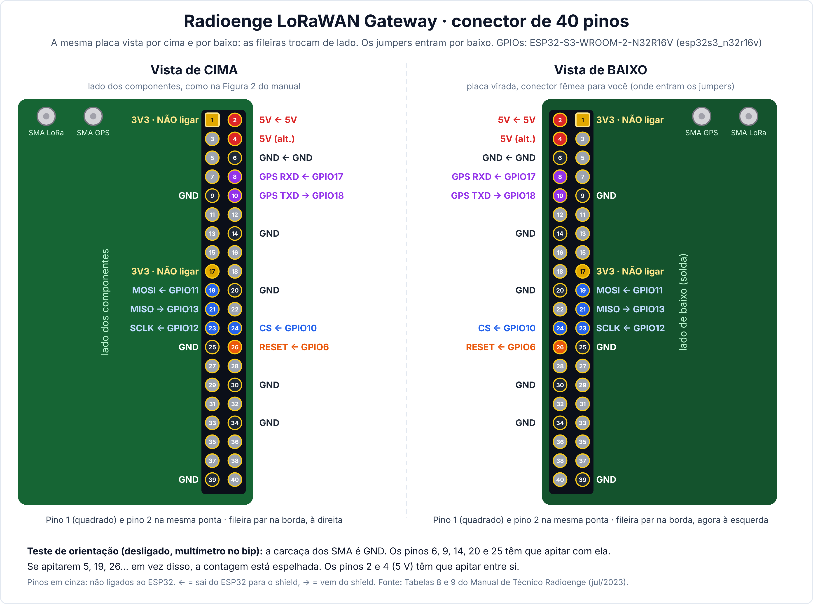
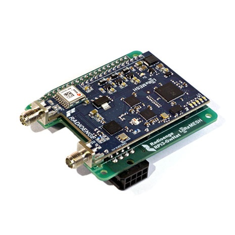
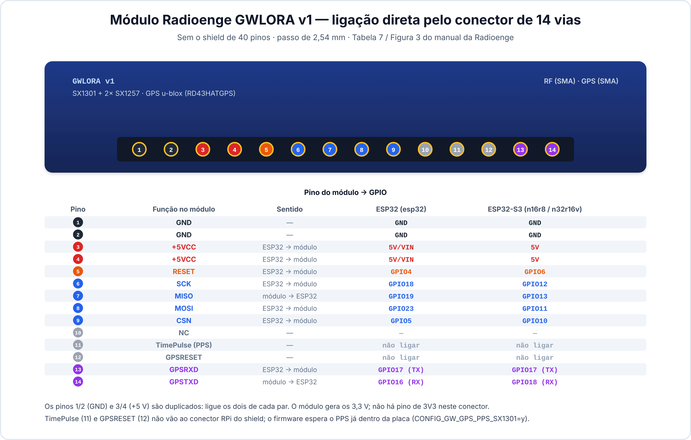
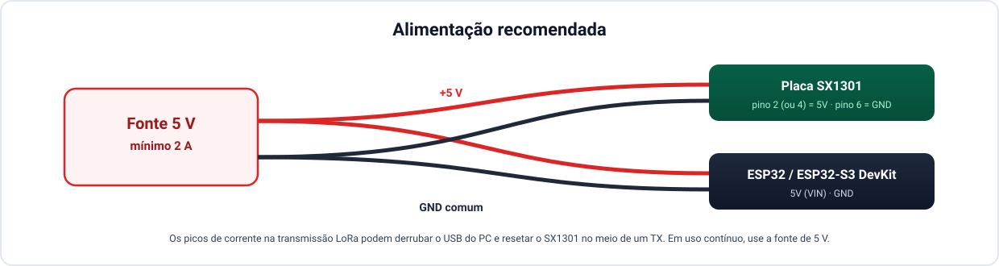

# Ligações — ESP32-S3-WROOM-2-N32R16V DevKit ↔ Radioenge LoRaWAN Gateway (RD43HAT / RD43HATGPS, SPI)

Projeto **ESP32_SX1301** (repositório `Gateway_ESP32_SX1301_RD43HATGPS_Radioenge`; gateway LoRaWAN de 8 canais com o Semtech SX1301, plano AU915). Placa **`BOARD=esp32s3_n32r16v`** (alvo `esp32s3`). É a pinagem compilada pelo bloco `if(IDF_TARGET STREQUAL "esp32s3")` de [`main/CMakeLists.txt`](../../main/CMakeLists.txt), ligada à **Radioenge LoRaWAN Gateway**, a placa concentradora principal do projeto (guia da placa: [`Radioenge_LoRaWAN_Gateway.md`](Radioenge_LoRaWAN_Gateway.md)). As outras placas: [ESP32-WROOM-32U](ESP32-WROOM-32U_DevKit.md) e [ESP32-S3-WROOM-1U-N16R8](ESP32-S3-WROOM-1U_N16R8_DevKit.md); comparação das três no [README desta pasta](README.md).

Os dois S3 usam **os mesmos fios**: este guia e o do N16R8 têm as mesmas ligações; mudam o firmware, a antena Wi-Fi e os GPIOs proibidos (47/48 de 1,8 V aqui).

| Item | Valor |
|---|---|
| Chip | ESP32-S3R16V, Xtensa LX7 dual-core 240 MHz, 512 KB SRAM |
| Flash | **32 MB octal (OPI), 1,8 V** |
| PSRAM | **16 MB octal, 1,8 V** |
| Antena Wi-Fi | de PCB (não tem u.FL) |
| Console | USB nativo (USB-Serial/JTAG, GPIO19/20) → `/dev/ttyACM0` |
| Arquivos do build | `sdkconfig.defaults` + `sdkconfig.defaults.esp32s3` + [`boards/esp32s3_n32r16v.defaults`](../../boards/esp32s3_n32r16v.defaults) + [`partitions_esp32s3.csv`](../../partitions_esp32s3.csv) |
| Build | `./scripts/build.sh esp32s3_n32r16v` → `build-esp32s3_n32r16v/` + `sdkconfig.esp32s3_n32r16v` |

> **Referência dos lados:**
> - **ESP32-S3:** layout da ESP32-S3-DevKitC-1 (2 × 22 pinos), vista de cima, com os conectores USB para baixo. Placas genéricas podem ter outra ordem física, mas **o que vale é o número do GPIO** impresso na placa.
> - **Radioenge:** conector fêmea de 40 pinos no padrão do Raspberry Pi, na borda longa do shield. O pino 1 é o quadrado, marcado "3V3". **Os jumpers entram por baixo**, e por baixo as fileiras trocam de lado (seção 3.2).
> - **Outras placas SX1301** (RAK2245 Pi HAT, RAK831 com adaptador, iC880A): os fios são os mesmos, menos o **RESET**, que vai ao pino 11 na RAK2245 (seção 7).

> **Por que esses GPIOs** (módulo **WROOM-2 N32R16V**, com flash e PSRAM octais em **1,8 V**):
> - **GPIO26–32:** flash.
> - **GPIO33–37:** PSRAM octal.
> - **GPIO47/48:** ficam no domínio de 1,8 V; não ligar sinais de 3,3 V.
> - **GPIO19/20:** USB nativo, onde fica o console.
> - **GPIO43/44:** UART0.
> - **GPIO0/3/45/46:** strapping.
>
> A pinagem abaixo evita todos eles.

<p align="center"></p>

<p align="center">
  <a href="../images/wiring_esp32s3_wroom2.png"></a>
</p>
<p align="center"><sub>🔍 Alta resolução (PNG, 3720 px de largura): clique na imagem para ampliar · versão vetorial: <a href="../images/wiring_esp32s3_wroom2.svg"><code>wiring_esp32s3_wroom2.svg</code></a></sub></p>

---

## 1. Tabela de ligações

| # | Sinal | ESP32-S3 (GPIO) | Sentido | Radioenge (pino do conector de 40) | Módulo GWLORA (14 vias) | Nome no padrão RPi |
|---|-------|:---:|:-------:|:---:|:---:|--------------------|
| 1 | SPI MOSI | **GPIO11** | → | **19** | 8 | GPIO10 / MOSI |
| 2 | SPI MISO | **GPIO13** | ← | **21** | 7 | GPIO9 / MISO |
| 3 | SPI SCLK | **GPIO12** | → | **23** | 6 | GPIO11 / SCLK |
| 4 | CS do SX1301 | **GPIO10** | → | **24** | 9 (CSN) | GPIO8 / CE0 |
| 5 | RESET do SX1301 (ativo em nível alto) | **GPIO6** | → | **26** | 5 | GPIO7 / CE1 |
| 6 | GPS RXD da placa *(só RD43HATGPS)* | **GPIO17** (TX) | → | **8** | 13 | GPIO14 / TXD |
| 7 | GPS TXD da placa *(só RD43HATGPS)* | **GPIO18** (RX) | ← | **10** | 14 | GPIO15 / RXD |
| 8 | Alimentação 5 V | **5V** | → | **2** e/ou **4** | 3 e 4 | 5V |
| 9 | Terra | **GND** | — | **6** (e 9, 14, 20, 25…) | 1 e 2 | GND |

Ao todo são **9 fios** (7 sem o GPS). Controlador SPI: `SPI2_HOST` (FSPI, IOMUX), modo 0, 8 MHz.

**SPI:** GPIO10–13 são os pinos nativos (IOMUX) do FSPI/SPI2 do S3 (`SX1301_SPI_HOST=SPI2_HOST`). Com eles o sinal não passa pela matriz de GPIO e aguenta clock mais alto.

**Opcional, fora da Radioenge:** display OLED SSD1306 I2C, ligado só ao ESP32 (seção 4.1).

| Sinal | ESP32-S3 (GPIO) | Sentido | OLED |
|---|:---:|:---:|---|
| I2C SDA | **GPIO4** | ↔ | SDA |
| I2C SCL | **GPIO5** | → | SCL |
| 3,3 V / GND | **3V3** / **GND** | → | VCC / GND |

**Não ligar:**
- **3V3 do conector (pinos 1 e 17).** A Radioenge gera os próprios 3,3 V a partir dos 5 V.
- **Pino 11.** É o RESET da RAK2245; na Radioenge ele não faz nada. O RESET da Radioenge é o **pino 26**.
- **Pinos 3 e 5 (I2C) do conector.** A HAL do SX1301 não usa I2C; o OLED vai direto ao ESP32.
- **POWER_EN.** A Radioenge não tem essa linha (`SX1301_POWER_EN_PIN=GPIO_NUM_NC`).
- **TimePulse (PPS) e GPSRESET** (pinos 11 e 12 do módulo de 14 vias). Não saem no conector de 40 pinos e não vão ao ESP32 (seção 7, item 4).

**Já na placa, sem fio extra:**
- **GPIO0:** botão BOOT. Se estiver pressionado logo após o reset, o gateway entra em modo Soft AP.
- **LED:** o LED da DevKit é RGB (WS2812), por isso `BLINK_GPIO=GPIO_NUM_NC`. Em algumas DevKits ele fica no GPIO48, que neste módulo está no domínio de 1,8 V.

**Livres para expansão** (LED de status, botão etc.): GPIO1, 2, 7, 8, 9, 14, 15, 16, 21, 38–42.

---

## 2. Pinout da ESP32-S3-DevKitC-1 (2 × 22), com os pinos usados

```
                        ┌─────────────────────────┐
                        │  ESP32-S3-WROOM-2       │
                        │  N32R16V (antena PCB)   │
                   ┌────┴─────────────────────────┴────┐
            3V3 ───┤ 1                               1 ├─── GND ◄────────── GND (pino 6)
            3V3 ───┤ 2                               2 ├─── GPIO43 (TX0)
            RST ───┤ 3                               3 ├─── GPIO44 (RX0)
SDA (OLED)   ►GPIO4┤ 4                               4 ├─── GPIO1
SCL (OLED)   ►GPIO5┤ 5                               5 ├─── GPIO2
RESET(p. 26)►GPIO6 ┤ 6                               6 ├─── GPIO42
          GPIO7 ───┤ 7                               7 ├─── GPIO41
         GPIO15 ───┤ 8                               8 ├─── GPIO40
         GPIO16 ───┤ 9                               9 ├─── GPIO39
GPS RXD(p. 8)►G17  ┤ 10                             10 ├─── GPIO38
GPS TXD(p.10)►G18  ┤ 11                             11 ├─── GPIO37 (PSRAM) ✗
          GPIO8 ───┤ 12                             12 ├─── GPIO36 (PSRAM) ✗
        ✗ GPIO3 ───┤ 13  (strapping)                13 ├─── GPIO35 (PSRAM) ✗
       ✗ GPIO46 ───┤ 14  (strapping)                14 ├─── GPIO0  (botão BOOT → Soft AP)
          GPIO9 ───┤ 15                             15 ├─── GPIO45 (strapping) ✗
CS SX1301(24)►G10  ┤ 16                             16 ├─── GPIO48 (1,8 V!) ✗
MOSI (p. 19)►G11   ┤ 17                             17 ├─── GPIO47 (1,8 V!) ✗
SCLK (p. 23)►G12   ┤ 18                             18 ├─── GPIO21
MISO (p. 21)►G13   ┤ 19                             19 ├─── GPIO20 (USB D+) ✗
         GPIO14 ───┤ 20                             20 ├─── GPIO19 (USB D−) ✗
  5V ◄─────────────┤ 21                             21 ├─── GND
  └─► p. 2/4   GND ┤ 22                             22 ├─── GND
                   └──────[ USB-UART ]────[ USB nativo ]──┘
                                          (console /dev/ttyACM0)

  ► = pino usado pelo gateway (p. = pino no conector da Radioenge)
  ✗ = não usar   GPIO17/18 só com a RD43HATGPS
```

---

## 3. Conector de 40 pinos da Radioenge, com os pinos usados

### 3.1 Vista de cima, com os GPIOs do ESP32-S3-WROOM-2-N32R16V

<p align="center">
  <a href="../images/radioenge_header_esp32s3_n32r16v.png"></a>
</p>
<p align="center"><sub>🔍 Alta resolução (PNG, 3720 px de largura): clique na imagem para ampliar · versão vetorial: <a href="../images/radioenge_header_esp32s3_n32r16v.svg"><code>radioenge_header_esp32s3_n32r16v.svg</code></a></sub></p>

```
         Vista de CIMA (lado dos componentes; fileira par na borda da placa)
                ┌──────────────┐
  3V3   (n/c)   │  1 ○    ● 2  │  5V   ◄──── 5V do ESP32-S3
  GPIO2 (SDA)   │  3 ○    ● 4  │  5V   (alternativo ao 2)
  GPIO3 (SCL)   │  5 ○    ● 6  │  GND  ◄──── GND do ESP32-S3
  GPIO4         │  7 ○    ◐ 8  │  TXD → GPS RXD   ◄─ GPIO17 [RD43HATGPS]
  GND           │  9 ○    ◐ 10 │  RXD ← GPS TXD   ─► GPIO18 [RD43HATGPS]
  GPIO17 (RAK)  │ 11 ○    ○ 12 │  GPIO18
  GPIO27        │ 13 ○    ○ 14 │  GND
  GPIO22        │ 15 ○    ○ 16 │  GPIO23
  3V3   (n/c)   │ 17 ○    ○ 18 │  GPIO24
  MOSI  ◄─GPIO11│ 19 ●    ○ 20 │  GND
  MISO  ─►GPIO13│ 21 ●    ○ 22 │  GPIO25
  SCLK  ◄─GPIO12│ 23 ●    ● 24 │  CE0 (CS SX1301) ◄─ GPIO10
  GND           │ 25 ○    ● 26 │  CE1 → RESET SX1301 ◄─ GPIO6
  ID_SD         │ 27 ○    ○ 28 │  ID_SC
  GPIO5         │ 29 ○    ○ 30 │  GND
  GPIO6         │ 31 ○    ○ 32 │  GPIO12
  GPIO13        │ 33 ○    ○ 34 │  GND
  GPIO19        │ 35 ○    ○ 36 │  GPIO16
  GPIO26        │ 37 ○    ○ 38 │  GPIO20
  GND           │ 39 ○    ○ 40 │  GPIO21
                └──────────────┘

  ● = ligado   ◐ = ligado só com GPS (RD43HATGPS)   ○ = livre   (n/c) = não conectar
  Pino 11 (GPIO17 RAK) = RESET da RAK2245: na Radioenge fica LIVRE (o RESET é o 26).
  Os nomes "GPIOxx" do conector são numeração do Raspberry Pi (BCM),
  NÃO são os GPIOs do ESP32-S3.
```

### 3.2 Vista de baixo: é por ela que os jumpers entram

> ⚠️ **Os jumpers entram por baixo do shield, e por baixo as fileiras trocam de lado.** O conector fêmea fica sob a placa: olhando por baixo, o pino 2 aparece à **esquerda** do pino 1. Contar os pinos por baixo usando a vista de cima põe cada fio na fileira errada (o 5 V cai no pino 1, de 3V3, e o módulo fica sem alimentação). No log isso aparece como `NOT EXPECTED CHIP VERSION (v0)` e `MISO is held LOW even with the SX1301 deselected`. **Antes de ligar**, com tudo desligado e o multímetro no bip: a carcaça dos SMA é GND, e os pinos 6, 9, 14, 20 e 25 têm que apitar com ela.

<p align="center">
  <a href="../images/radioenge_header_cima_baixo_esp32s3_n32r16v.png"></a>
</p>
<p align="center"><sub>🔍 Alta resolução (PNG, 3600 px de largura): clique na imagem para ampliar · versão vetorial: <a href="../images/radioenge_header_cima_baixo_esp32s3_n32r16v.svg"><code>radioenge_header_cima_baixo_esp32s3_n32r16v.svg</code></a></sub></p>

```
         Vista de BAIXO (placa virada: é por aqui que entram os jumpers)
                       ┌──────────────┐
              5V ◄─ 5V │  2 ●    ○ 1  │  3V3 (n/c)
             5V (alt.) │  4 ●    ○ 3  │
            GND ◄─ GND │  6 ●    ○ 5  │
     GPS RXD ◄─ GPIO17 │  8 ◐    ○ 7  │
     GPS TXD ─► GPIO18 │ 10 ◐    ○ 9  │  GND
                       │ 12 ○    ○ 11 │
                   GND │ 14 ○    ○ 13 │
                       │ 16 ○    ○ 15 │
                       │ 18 ○    ○ 17 │  3V3 (n/c)
                   GND │ 20 ○    ● 19 │  MOSI ◄─ GPIO11
                       │ 22 ○    ● 21 │  MISO ─► GPIO13
          CS ◄─ GPIO10 │ 24 ●    ● 23 │  SCLK ◄─ GPIO12
        RESET ◄─ GPIO6 │ 26 ●    ○ 25 │  GND
                       │  ⋮         ⋮ │  (27 a 40: nenhum fio)
                       └──────────────┘

  Por baixo a fileira PAR fica à ESQUERDA. O pino 1 (quadrado) continua na mesma ponta do 2.
  Teste do bip (tudo desligado): carcaça dos SMA = GND → pinos 6, 9, 14, 20 e 25 apitam.
```

<p align="center">
  <a href="../images/radioenge/radioenge_hat_foto.jpg"></a>
</p>
<p align="center"><sub>Radioenge LoRaWAN Gateway: o conector fêmea de 40 pinos fica na borda longa do shield. Para uma montagem sem jumpers, a placa adaptadora de <a href="../../hardware_design/"><code>hardware_design/</code></a> recebe a Radioenge num 2×20, como um Raspberry Pi.</sub></p>

---

## 4. Diagrama de ligação (bloco a bloco)

```
   ┌──────────────────────────┐                        ┌──────────────────────────────┐
   │ ESP32-S3-WROOM-2 DevKit  │                        │ Radioenge LoRaWAN Gateway    │
   │ N32R16V (32 MB / 16 MB)  │                        │ SX1301 + 2× SX1257 (RD43HAT) │
   │                          │ ── SPI (SPI2/FSPI) ──  │                              │
   │                   GPIO11 ├───────── MOSI ────────►│ 19  MOSI                     │
   │                   GPIO13 │◄──────── MISO ─────────┤ 21  MISO                     │
   │                   GPIO12 ├───────── SCLK ────────►│ 23  SCLK                     │
   │                   GPIO10 ├───────── CS ──────────►│ 24  CE0  (CS do SX1301)      │
   │                          │                        │                              │
   │                          │     ── Controle ──     │                              │
   │                    GPIO6 ├───────── RESET ───────►│ 26  RESET SX1301 (ativo alto)│
   │                          │                        │                              │
   │                          │ ── GPS (RD43HATGPS) ── │                              │
   │                   GPIO17 ├───────── TX ──────────►│  8  GPS RXD                  │
   │                   GPIO18 │◄──────── RX ───────────┤ 10  GPS TXD                  │
   │                          │                        │                              │
   │                          │     ── Energia ──      │                              │
   │                       5V ├───────── 5 V ─────────►│ 2/4  5V                      │
   │                      GND ├───────── GND ──────────┤  6   GND                     │
   └────────────┬─────────────┘                        └──────────────┬───────────────┘
                │ antena PCB                                          │ SMA LoRa
          (Wi-Fi, afastar da Radioenge)                      antena LoRa 902–928 MHz
                                                     (NUNCA transmitir sem antena)
```

### 4.1 Display OLED (opcional)

```
   ESP32-S3                         OLED SSD1306 I2C (opcional)
   GPIO4   ◄──────── SDA ────────►  SDA
   GPIO5   ───────── SCL ────────►  SCL
   3V3     ───────── VCC ────────►  VCC
   GND     ───────── GND ─────────  GND

   O OLED NÃO vai ao conector da Radioenge (pinos 3 e 5 ficam livres: a HAL do SX1301 não usa I2C).
```

---

## 5. Ligação direta no conector de 14 vias do módulo GWLORA

Sem o shield de 40 pinos (módulo "LoRaMESH Gateway" GWLORA v1, passo de 2,54 mm, Figura 3 do manual da Radioenge), os mesmos sinais saem no conector de 14 vias do módulo:

| Pino do módulo | Função | Sentido | ESP32-S3 (GPIO) |
|:---:|---|:---:|:---:|
| 1 e 2 | GND | — | GND |
| 3 e 4 | +5 V | → | 5V |
| 5 | RESET (ativo alto) | → | **GPIO6** |
| 6 | SCK | → | GPIO12 |
| 7 | MISO | ← | GPIO13 |
| 8 | MOSI | → | GPIO11 |
| 9 | CSN | → | GPIO10 |
| 10 | NC |  | — |
| 11 | TimePulse (PPS) |  | não ligar |
| 12 | GPSRESET |  | não ligar |
| 13 | GPSRXD *(RD43HATGPS)* | → | GPIO17 (TX) |
| 14 | GPSTXD *(RD43HATGPS)* | ← | GPIO18 (RX) |

Os pinos 1/2 (GND) e 3/4 (+5 V) são duplicados: ligue os dois de cada par. O módulo gera os 3,3 V; não há pino de 3V3 neste conector.

<p align="center">
  <a href="../images/radioenge_modulo_14vias.png"></a>
</p>
<p align="center"><sub>🔍 Alta resolução (PNG, 3720 px de largura): clique na imagem para ampliar · versão vetorial: <a href="../images/radioenge_modulo_14vias.svg"><code>radioenge_modulo_14vias.svg</code></a></sub></p>

---

## 6. Alimentação

```
      Fonte 5 V / 2 A ──┬──────────────► Radioenge pino 2 (ou 4)   5V
      (4,6–5,5 V)       │
                        └──────────────► ESP32-S3 5V (J1-21)
      GND da fonte ─────┬──────────────► Radioenge pino 6          GND
                        └──────────────► ESP32-S3 GND

      Consumo: Radioenge 300 mA (RX) / 700 mA (TX +27 dBm) + ESP32 (picos de ~350 mA no Wi-Fi) > 1 A
```

- A Radioenge consome **300 mA recebendo** e **700 mA transmitindo** a +27 dBm. Com o ESP32 (Wi-Fi com picos de ~350 mA), o conjunto passa de **1 A**.
- **A USB do PC (500 mA) não basta**, nem durante o desenvolvimento: aparecem *brownout* do ESP32 ou reset do SX1301 no meio do TX. Use sempre a **fonte de 5 V / 2 A**, ligada aos pinos 2/4 do conector (ou ao 5V da DevKit).
- Tensão de operação da Radioenge: 4,6 a 5,5 V. Acima de 5,5 V a placa pode ser danificada.
- **O GND precisa ser comum** a tudo.
- Não alimente a Radioenge pelo regulador de 3,3 V da DevKit.
- A lógica da Radioenge é **3,3 V**. Todos os GPIOs usados (4–6, 10–13, 17, 18) são de 3,3 V no S3, então não precisa de conversor de nível. Não use GPIO47/48: neste módulo eles ficam no domínio de 1,8 V.

<p align="center"></p>

---

## 7. Observações

1. **Fios SPI curtos**, idealmente com menos de 10–15 cm e de mesmo comprimento. Jumpers longos causam erros de leitura do SX1301 (`failed to start the concentrator`). O clock padrão é 8 MHz (`SPI_SPEED` em `main/libloragw/loragw_spi.h`); com fios longos, baixe para 2–4 MHz.
2. **RESET (GPIO6 → pino 26)** é ativo em **nível alto**, como no `reset_lgw.sh` da Radioenge no Raspberry Pi (`reset_pin=7`, BCM GPIO7). O firmware gera o pulso sozinho no boot (`lgw_reset()`, em `main/libloragw/loragw_gpio.c`: nível 1 por 100 ms e volta a 0).
3. **Outras placas SX1301:** na RAK2245 Pi HAT o RESET vai ao **pino 11**; em alguns adaptadores do iC880A/RAK831, ao pino 22. Mude só a ponta do fio no conector: o GPIO do ESP32-S3 continua o GPIO6. Os outros 8 fios são iguais.
4. **GPS e PPS (só RD43HATGPS):** ligue os pinos 8/10 e ative o GPS na página web (seção **GPS**) ou no console com `gps on`. A saída *TimePulse* (PPS) não chega ao conector de 40 pinos; o firmware espera o PPS já no SX1301, dentro da placa (`CONFIG_GW_GPS_PPS_SX1301=y`, padrão). Confira a referência de tempo na primeira montagem ([guia da Radioenge](Radioenge_LoRaWAN_Gateway.md#5-gps-e-pps-rd43hatgps)). Na RD43HAT (sem GPS), deixe o GPS desligado.
5. **Um só chip select e nenhum sensor de temperatura:** o SX1301 não tem rádio auxiliar no SPI, e a HAL do SX1301 não usa I2C. O I2C (GPIO4/GPIO5) fica só para o OLED opcional.
6. **Conferência no boot:** o monitor mostra `*** Board: ESP32-S3-WROOM-2-N32R16V (esp32s3_n32r16v, esp32s3) ***` logo depois da versão. Se aparecer outro nome, o firmware gravado é de outra placa.
7. **Antena Wi-Fi:** o WROOM-2 só tem antena de PCB. Deixe a ponta do módulo, onde fica a antena, para fora da caixa e longe da Radioenge e de partes metálicas.
8. **Console:** o `idf.py monitor` e o prompt `ESP32_SX1301>` ficam na porta USB nativa (`/dev/ttyACM0`, GPIO19/20).
9. **Antena LoRa:** nunca ligue o gateway sem antena no SMA de LoRa da Radioenge. O manual avisa que isso danifica o módulo (902–928 MHz, SMA-macho, até 6 dBi).

---

## 8. Conferência rápida depois de ligar

No monitor serial, o boot deve mostrar:

```
*** Board: ESP32-S3-WROOM-2-N32R16V (esp32s3_n32r16v, esp32s3) ***
INFO: [main] concentrator started, packet can now be received
INFO: [heap] stats: free ..., largest block ..., minimum ever ... bytes
I (...) gw_mqtt: connected to the broker          ← quando o MQTT está ligado
```

Se aparecer `failed to start the concentrator`, o firmware roda o `sx1301_wiring_diag` antes de reiniciar (em 20 s):

| Conferência | O esperado | Se falhar |
|---|---|---|
| Versão do chip | `[2] reset active-HIGH ...: chip version 103 (0x67)` | nenhuma combinação lê 103, ou só a "active-LOW": confira se o RESET (GPIO6) está no pino **26**, e não no 11 |
| CS / MISO | `the SX1301 is answering the chip select` | fio do CS (GPIO10) fora do pino 24, ou Radioenge sem 5 V |
| MISO com o chip desligado | `[1] ... CS HIGH (not selected): 1 / 0` | `0 / 0` e versão `v0`: módulo sem 5 V ou fios na fileira trocada; confira a [vista de baixo](#32-vista-de-baixo-é-por-ela-que-os-jumpers-entram) e o teste do bip |
| Só lê a versão a 500 kHz | — | fios longos ou mal encostados: encurte ou baixe o `SPI_SPEED` |
| Transmissão | `tx_ok` nas estatísticas, *join accept* chegando | fonte de 5 V / 2 A e antena |

**GPS (se ligado na página):** `INFO: [gps] GPS switched on: UART1 9600 baud, ESP32 RX GPIO18 <- header pin 10, TX GPIO17 -> header pin 8`. Se aparecer `WARNING: [gps] no data from the GPS for N s (check header pin 10 -> ESP32 GPIO18, GND and 5 V)`, nenhum byte chega no GPIO18: confira o pino 10, o GND comum e os 5 V.

---

## 9. Configuração do firmware, compilar e gravar

O [`boards/esp32s3_n32r16v.defaults`](../../boards/esp32s3_n32r16v.defaults) traz as opções do **WROOM-2 N32R16V**. Sem elas o módulo não inicia, porque a flash e a PSRAM são **octais**:

```
CONFIG_GW_BOARD_ESP32S3_WROOM_2_N32R16V=y
CONFIG_ESPTOOLPY_OCT_FLASH=y            # flash octal (OPI)
CONFIG_ESPTOOLPY_FLASHFREQ_80M=y
CONFIG_ESPTOOLPY_FLASHSIZE_32MB=y
CONFIG_SPIRAM=y
CONFIG_SPIRAM_MODE_OCT=y                # PSRAM octal
CONFIG_SPIRAM_SPEED_80M=y
CONFIG_SPIRAM_USE_MALLOC=y
```

Do [`sdkconfig.defaults.esp32s3`](../../sdkconfig.defaults.esp32s3), comum aos dois S3:

```
CONFIG_ESP_CONSOLE_USB_SERIAL_JTAG=y    # console no USB nativo (/dev/ttyACM0)
CONFIG_PARTITION_TABLE_CUSTOM=y         # partitions_esp32s3.csv: app de 4 MB em 0x10000
```

Mover a sessão TLS e as filas para a PSRAM fica para a próxima etapa (veja o roadmap no README).

Com o ESP-IDF já ativado (instalação no Linux, macOS ou Windows: seção [Preparar o ambiente ESP-IDF](../../README.md#-preparar-o-ambiente-esp-idf) do README):

```bash
./scripts/build.sh esp32s3_n32r16v                     # só compila
./scripts/build.sh esp32s3_n32r16v flash /dev/ttyACM0  # porta "USB" (nativa), não a "UART"
./scripts/build.sh esp32s3_n32r16v monitor /dev/ttyACM0
```

**Com log em `logs/`** (Linux/WSL2; os mesmos comandos de [Gravar e acompanhar o log](../../README.md#gravar-e-acompanhar-o-log) do README). Porta desta placa: `/dev/ttyACM0`, porta USB nativa. **Do zero** apaga a configuração; **Atualizar** mantém a configuração.

**Do zero:** apaga a flash, compila do zero, grava e abre o monitor

```bash
sudo fuser -k /dev/ttyACM0 2>/dev/null ; \
cd ~/Apps/esp-idf/ && \
. ./export.sh && \
cd ~/Apps/lorawan_workspace/Gateway_ESP32_SX1301_RD43HATGPS_Radioenge && \
mkdir -p logs && \
LOG=logs/esp32s3_n32r16v_$(date +%Y%m%d_%H%M%S).log && \
script -f -q -c "rm -rf build-esp32s3_n32r16v sdkconfig.esp32s3_n32r16v managed_components dependencies.lock && sh scripts/build.sh esp32s3_n32r16v erase /dev/ttyACM0 && sh scripts/build.sh esp32s3_n32r16v flash /dev/ttyACM0" "$LOG" ; \
sed -r 's/\x1B\[[0-9;]*[mK]//g; s/\r//g' "$LOG" > "${LOG%.log}_limpo.log" && \
echo "Logs salvos em: $LOG e ${LOG%.log}_limpo.log"
```

**Atualizar:** compila do zero, grava e abre o monitor (mantém a configuração)

```bash
sudo fuser -k /dev/ttyACM0 2>/dev/null ; \
cd ~/Apps/esp-idf/ && \
. ./export.sh && \
cd ~/Apps/lorawan_workspace/Gateway_ESP32_SX1301_RD43HATGPS_Radioenge && \
mkdir -p logs && \
LOG=logs/esp32s3_n32r16v_update_$(date +%Y%m%d_%H%M%S).log && \
script -f -q -c "rm -rf build-esp32s3_n32r16v sdkconfig.esp32s3_n32r16v managed_components dependencies.lock && sh scripts/build.sh esp32s3_n32r16v flash /dev/ttyACM0" "$LOG" ; \
sed -r 's/\x1B\[[0-9;]*[mK]//g; s/\r//g' "$LOG" > "${LOG%.log}_limpo.log" && \
echo "Logs salvos em: $LOG e ${LOG%.log}_limpo.log"
```

**Só monitorar:** sem compilar nem gravar

```bash
sudo fuser -k /dev/ttyACM0 2>/dev/null ; \
cd ~/Apps/esp-idf/ && \
. ./export.sh && \
cd ~/Apps/lorawan_workspace/Gateway_ESP32_SX1301_RD43HATGPS_Radioenge && \
mkdir -p logs && \
LOG=logs/esp32s3_n32r16v_monitor_$(date +%Y%m%d_%H%M%S).log && \
script -f -q -c "sh scripts/build.sh esp32s3_n32r16v monitor /dev/ttyACM0" "$LOG" ; \
sed -r 's/\x1B\[[0-9;]*[mK]//g; s/\r//g' "$LOG" > "${LOG%.log}_limpo.log" && \
echo "Logs salvos em: $LOG e ${LOG%.log}_limpo.log"
```

Sem o script (Windows nativo):

```powershell
idf.py -B build-esp32s3_n32r16v -D SDKCONFIG=sdkconfig.esp32s3_n32r16v -D IDF_TARGET=esp32s3 -D BOARD=esp32s3_n32r16v build
idf.py -B build-esp32s3_n32r16v -D SDKCONFIG=sdkconfig.esp32s3_n32r16v -D IDF_TARGET=esp32s3 -D BOARD=esp32s3_n32r16v -p COM6 flash monitor
```

Binário pronto da Release: `Gateway_ESP32_SX1301_RD43HATGPS_Radioenge-<versão>-esp32s3_n32r16v-full.bin` (gravar em `0x0`).

> **Não grave o firmware do N16R8 neste módulo.** O N16R8 usa flash quad de 3,3 V; com ele o N32R16V não inicia.
