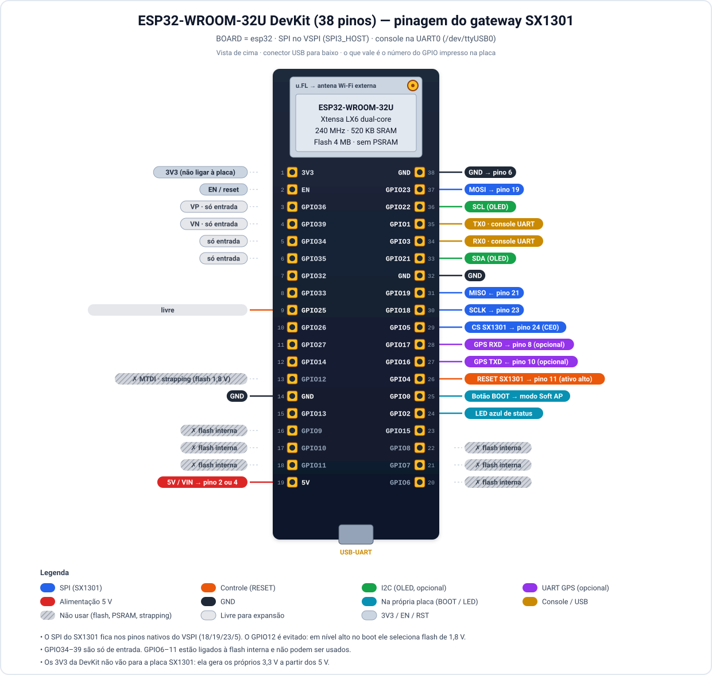
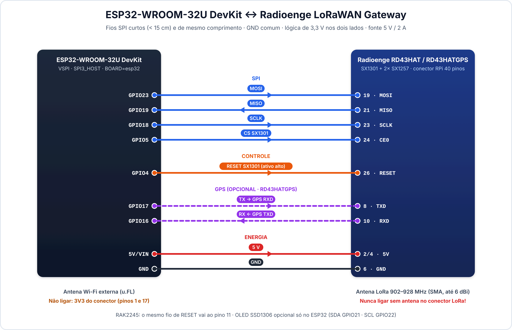
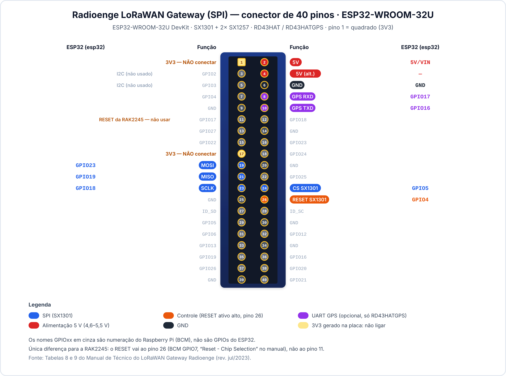
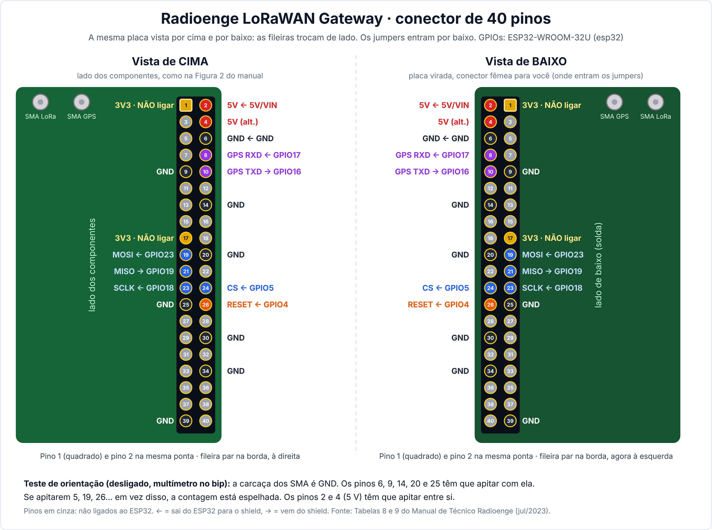
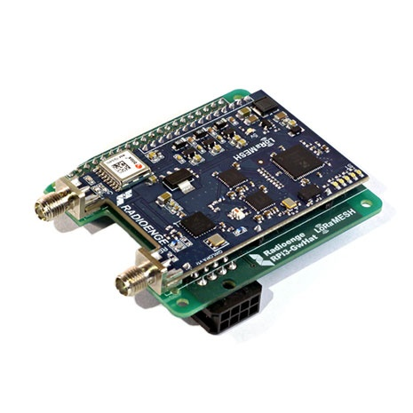
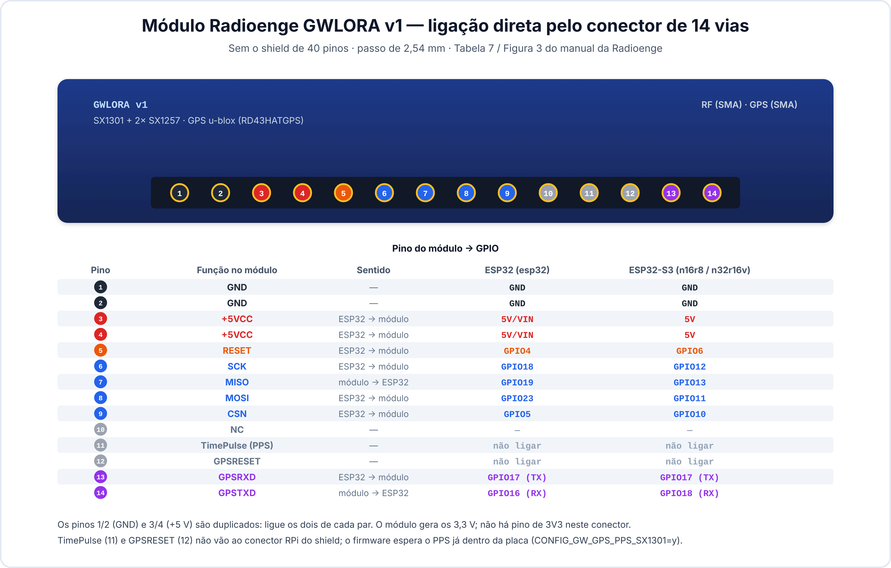
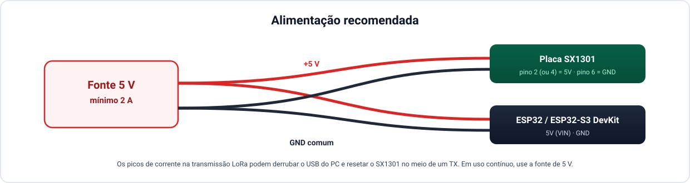

# Ligações — ESP32-WROOM-32U DevKit ↔ Radioenge LoRaWAN Gateway (RD43HAT / RD43HATGPS, SPI)

Projeto **ESP32_SX1301** (repositório `Gateway_ESP32_SX1301_RD43HATGPS_Radioenge`; gateway LoRaWAN de 8 canais com o Semtech SX1301, plano AU915). Placa **`BOARD=esp32`** (alvo `esp32`). É a pinagem compilada pelo bloco `elseif(IDF_TARGET STREQUAL "esp32")` de [`main/CMakeLists.txt`](../../main/CMakeLists.txt), ligada à **Radioenge LoRaWAN Gateway**, a placa concentradora principal do projeto (guia da placa: [`Radioenge_LoRaWAN_Gateway.md`](Radioenge_LoRaWAN_Gateway.md)). As outras placas: [ESP32-S3-WROOM-1U-N16R8](ESP32-S3-WROOM-1U_N16R8_DevKit.md) e [ESP32-S3-WROOM-2-N32R16V](ESP32-S3-WROOM-2_N32R16V_DevKit.md); comparação das três no [README desta pasta](README.md).

| Item | Valor |
|---|---|
| Chip | ESP32-D0WD-V3, Xtensa LX6 dual-core 240 MHz, 520 KB SRAM |
| Flash | 4 MB quad, 3,3 V (GPIO6–11) |
| PSRAM | não tem |
| Antena Wi-Fi | externa, conector u.FL |
| Console | UART0 (chip USB-UART da DevKit) → `/dev/ttyUSB0` |
| Arquivos do build | `sdkconfig.defaults` + [`sdkconfig.defaults.esp32`](../../sdkconfig.defaults.esp32) + [`boards/esp32.defaults`](../../boards/esp32.defaults) (tabela `partitions_singleapp_large.csv`, app de 1,5 MB) |
| Build | `./scripts/build.sh esp32` → `build-esp32/` + `sdkconfig.esp32` |

> **Referência dos lados:**
> - **ESP32:** DevKitC de 38 pinos (ESP32-WROOM-32U, com conector u.FL), vista de cima e com o USB para baixo. DevKits de 30 pinos têm outra ordem física, mas **o que vale é o número do GPIO** impresso na placa.
> - **Radioenge:** conector fêmea de 40 pinos no padrão do Raspberry Pi, na borda longa do shield. O pino 1 é o quadrado, marcado "3V3". **Os jumpers entram por baixo**, e por baixo as fileiras trocam de lado (seção 3.2).
> - **Outras placas SX1301** (RAK2245 Pi HAT, RAK831 com adaptador, iC880A): os fios são os mesmos, menos o **RESET**, que vai ao pino 11 na RAK2245 (seção 7).

<p align="center"></p>

<p align="center">
  <a href="../images/wiring_esp32_wroom32u.png"></a>
</p>
<p align="center"><sub>🔍 Alta resolução (PNG, 3720 px de largura): clique na imagem para ampliar · versão vetorial: <a href="../images/wiring_esp32_wroom32u.svg"><code>wiring_esp32_wroom32u.svg</code></a></sub></p>

---

## 1. Tabela de ligações

| # | Sinal | ESP32 (GPIO) | Sentido | Radioenge (pino do conector de 40) | Módulo GWLORA (14 vias) | Nome no padrão RPi |
|---|-------|:---:|:-------:|:---:|:---:|--------------------|
| 1 | SPI MOSI | **GPIO23** | → | **19** | 8 | GPIO10 / MOSI |
| 2 | SPI MISO | **GPIO19** | ← | **21** | 7 | GPIO9 / MISO |
| 3 | SPI SCLK | **GPIO18** | → | **23** | 6 | GPIO11 / SCLK |
| 4 | CS do SX1301 | **GPIO5** | → | **24** | 9 (CSN) | GPIO8 / CE0 |
| 5 | RESET do SX1301 (ativo em nível alto) | **GPIO4** | → | **26** | 5 | GPIO7 / CE1 |
| 6 | GPS RXD da placa *(só RD43HATGPS)* | **GPIO17** (TX) | → | **8** | 13 | GPIO14 / TXD |
| 7 | GPS TXD da placa *(só RD43HATGPS)* | **GPIO16** (RX) | ← | **10** | 14 | GPIO15 / RXD |
| 8 | Alimentação 5 V | **5V / VIN** | → | **2** e/ou **4** | 3 e 4 | 5V |
| 9 | Terra | **GND** | — | **6** (e 9, 14, 20, 25…) | 1 e 2 | GND |

Ao todo são **9 fios** (7 sem o GPS). Controlador SPI: `SPI3_HOST` (VSPI), modo 0, 8 MHz.

**Opcional, fora da Radioenge:** display OLED SSD1306 I2C, ligado só ao ESP32 (seção 4.1).

| Sinal | ESP32 (GPIO) | Sentido | OLED |
|---|:---:|:---:|---|
| I2C SDA | **GPIO21** | ↔ | SDA |
| I2C SCL | **GPIO22** | → | SCL |
| 3,3 V / GND | **3V3** / **GND** | → | VCC / GND |

**Não ligar:**
- **3V3 do conector (pinos 1 e 17).** A Radioenge gera os próprios 3,3 V a partir dos 5 V.
- **Pino 11.** É o RESET da RAK2245; na Radioenge ele não faz nada. O RESET da Radioenge é o **pino 26**.
- **Pinos 3 e 5 (I2C) do conector.** A HAL do SX1301 não usa I2C; o OLED vai direto ao ESP32.
- **POWER_EN.** A Radioenge não tem essa linha (`SX1301_POWER_EN_PIN=GPIO_NUM_NC`).
- **TimePulse (PPS) e GPSRESET** (pinos 11 e 12 do módulo de 14 vias). Não saem no conector de 40 pinos e não vão ao ESP32 (seção 7, item 4).

**Já na placa, sem fio extra:**
- **GPIO0:** botão BOOT. Se estiver pressionado logo após o reset, o gateway entra em modo Soft AP.
- **GPIO2:** LED azul da DevKit (`BLINK_GPIO=2`).

**Pinos que não devem ser usados:**
- **GPIO6 a GPIO11:** ligados à flash SPI interna.
- **GPIO12 (MTDI):** pino de strapping. Se estiver em nível alto no boot, seleciona flash de 1,8 V e o ESP32 não inicia. Por isso o SPI da Radioenge fica nos pinos nativos do VSPI (18/19/23/5).
- **GPIO34 a GPIO39:** só funcionam como entrada.

**Livres para expansão:** GPIO13, 14, 25, 26, 27, 32 e 33.

---

## 2. Pinout da DevKitC (38 pinos), com os pinos usados

```
                         ┌───────────────────┐
                         │   ESP32-WROOM-32U │
                         │   (antena u.FL)   │
                    ┌────┴───────────────────┴────┐
              3V3 ──┤ 1                       38 ├── GND ◄──────── GND (pino 6)
               EN ──┤ 2                       37 ├── GPIO23 ◄───── MOSI (pino 19)
     GPIO36 (VP) ───┤ 3                       36 ├── GPIO22 ◄───── SCL  (OLED)  
     GPIO39 (VN) ───┤ 4                       35 ├── GPIO1  (TX0 / console)
           GPIO34 ──┤ 5                       34 ├── GPIO3  (RX0 / console)
           GPIO35 ──┤ 6                       33 ├── GPIO21 ◄───── SDA  (OLED)  
           GPIO32 ──┤ 7                       32 ├── GND
           GPIO33 ──┤ 8                       31 ├── GPIO19 ◄───── MISO (pino 21)
           GPIO25 ──┤ 9                       30 ├── GPIO18 ◄───── SCLK (pino 23)
           GPIO26 ──┤ 10                      29 ├── GPIO5  ◄───── CS SX1301 (pino 24)
           GPIO27 ──┤ 11                      28 ├── GPIO17 ◄───── GPS RXD (pino 8)  [GPS]
           GPIO14 ──┤ 12                      27 ├── GPIO16 ◄───── GPS TXD (pino 10) [GPS]
  ✗ GPIO12 (MTDI) ──┤ 13                      26 ├── GPIO4  ◄───── RESET SX1301 (pino 26)
              GND ──┤ 14                      25 ├── GPIO0  (botão BOOT → Soft AP)
           GPIO13 ──┤ 15                      24 ├── GPIO2  (LED azul)
  ✗ GPIO9  (flash) ─┤ 16                      23 ├── GPIO15
  ✗ GPIO10 (flash) ─┤ 17                      22 ├── GPIO8  (flash) ✗
  ✗ GPIO11 (flash) ─┤ 18                      21 ├── GPIO7  (flash) ✗
   5V (VIN) ◄───────┤ 19                      20 ├── GPIO6  (flash) ✗
   └─► pinos 2/4    └─────────────[ USB ]─────────┘

  ◄── = pino usado pelo gateway (número do pino no conector da Radioenge)
  ✗ = não usar   [GPS] = só com a RD43HATGPS
```

---

## 3. Conector de 40 pinos da Radioenge, com os pinos usados

### 3.1 Vista de cima, com os GPIOs do ESP32-WROOM-32U

<p align="center">
  <a href="../images/radioenge_header_esp32.png"></a>
</p>
<p align="center"><sub>🔍 Alta resolução (PNG, 3720 px de largura): clique na imagem para ampliar · versão vetorial: <a href="../images/radioenge_header_esp32.svg"><code>radioenge_header_esp32.svg</code></a></sub></p>

```
         Vista de CIMA (lado dos componentes; fileira par na borda da placa)
                ┌──────────────┐
  3V3   (n/c)   │  1 ○    ● 2  │  5V   ◄──── 5V/VIN do ESP32
  GPIO2 (SDA)   │  3 ○    ● 4  │  5V   (alternativo ao 2)
  GPIO3 (SCL)   │  5 ○    ● 6  │  GND  ◄──── GND do ESP32
  GPIO4         │  7 ○    ◐ 8  │  TXD → GPS RXD   ◄─ GPIO17 [RD43HATGPS]
  GND           │  9 ○    ◐ 10 │  RXD ← GPS TXD   ─► GPIO16 [RD43HATGPS]
  GPIO17 (RAK)  │ 11 ○    ○ 12 │  GPIO18
  GPIO27        │ 13 ○    ○ 14 │  GND
  GPIO22        │ 15 ○    ○ 16 │  GPIO23
  3V3   (n/c)   │ 17 ○    ○ 18 │  GPIO24
  MOSI  ◄─GPIO23│ 19 ●    ○ 20 │  GND
  MISO  ─►GPIO19│ 21 ●    ○ 22 │  GPIO25
  SCLK  ◄─GPIO18│ 23 ●    ● 24 │  CE0 (CS SX1301) ◄─ GPIO5
  GND           │ 25 ○    ● 26 │  CE1 → RESET SX1301 ◄─ GPIO4
  ID_SD         │ 27 ○    ○ 28 │  ID_SC
  GPIO5         │ 29 ○    ○ 30 │  GND
  GPIO6         │ 31 ○    ○ 32 │  GPIO12
  GPIO13        │ 33 ○    ○ 34 │  GND
  GPIO19        │ 35 ○    ○ 36 │  GPIO16
  GPIO26        │ 37 ○    ○ 38 │  GPIO20
  GND           │ 39 ○    ○ 40 │  GPIO21
                └──────────────┘

  ● = ligado   ◐ = ligado só com GPS (RD43HATGPS)   ○ = livre   (n/c) = não conectar
  Pino 11 (GPIO17 RAK) = RESET da RAK2245: na Radioenge fica LIVRE (o RESET é o 26).
  Os nomes "GPIOxx" do conector são numeração do Raspberry Pi (BCM),
  NÃO são os GPIOs do ESP32.
```

### 3.2 Vista de baixo: é por ela que os jumpers entram

> ⚠️ **Os jumpers entram por baixo do shield, e por baixo as fileiras trocam de lado.** O conector fêmea fica sob a placa: olhando por baixo, o pino 2 aparece à **esquerda** do pino 1. Contar os pinos por baixo usando a vista de cima põe cada fio na fileira errada (o 5 V cai no pino 1, de 3V3, e o módulo fica sem alimentação). No log isso aparece como `NOT EXPECTED CHIP VERSION (v0)` e `MISO is held LOW even with the SX1301 deselected`. **Antes de ligar**, com tudo desligado e o multímetro no bip: a carcaça dos SMA é GND, e os pinos 6, 9, 14, 20 e 25 têm que apitar com ela.

<p align="center">
  <a href="../images/radioenge_header_cima_baixo_esp32.png"></a>
</p>
<p align="center"><sub>🔍 Alta resolução (PNG, 3600 px de largura): clique na imagem para ampliar · versão vetorial: <a href="../images/radioenge_header_cima_baixo_esp32.svg"><code>radioenge_header_cima_baixo_esp32.svg</code></a></sub></p>

```
         Vista de BAIXO (placa virada: é por aqui que entram os jumpers)
                       ┌──────────────┐
          5V ◄─ 5V/VIN │  2 ●    ○ 1  │  3V3 (n/c)
             5V (alt.) │  4 ●    ○ 3  │
            GND ◄─ GND │  6 ●    ○ 5  │
     GPS RXD ◄─ GPIO17 │  8 ◐    ○ 7  │
     GPS TXD ─► GPIO16 │ 10 ◐    ○ 9  │  GND
                       │ 12 ○    ○ 11 │
                   GND │ 14 ○    ○ 13 │
                       │ 16 ○    ○ 15 │
                       │ 18 ○    ○ 17 │  3V3 (n/c)
                   GND │ 20 ○    ● 19 │  MOSI ◄─ GPIO23
                       │ 22 ○    ● 21 │  MISO ─► GPIO19
           CS ◄─ GPIO5 │ 24 ●    ● 23 │  SCLK ◄─ GPIO18
        RESET ◄─ GPIO4 │ 26 ●    ○ 25 │  GND
                       │  ⋮         ⋮ │  (27 a 40: nenhum fio)
                       └──────────────┘

  Por baixo a fileira PAR fica à ESQUERDA. O pino 1 (quadrado) continua na mesma ponta do 2.
  Teste do bip (tudo desligado): carcaça dos SMA = GND → pinos 6, 9, 14, 20 e 25 apitam.
```

<p align="center">
  <a href="../images/radioenge/radioenge_hat_foto.jpg"></a>
</p>
<p align="center"><sub>Radioenge LoRaWAN Gateway: o conector fêmea de 40 pinos fica na borda longa do shield. Para uma montagem sem jumpers, a placa adaptadora de <a href="../../hardware_design/"><code>hardware_design/</code></a> recebe a Radioenge num 2×20, como um Raspberry Pi.</sub></p>

---

## 4. Diagrama de ligação (bloco a bloco)

```
   ┌──────────────────────────┐                        ┌──────────────────────────────┐
   │  ESP32-WROOM-32U DevKit  │                        │ Radioenge LoRaWAN Gateway    │
   │ (38 pinos, antena u.FL)  │                        │ SX1301 + 2× SX1257 (RD43HAT) │
   │                          │    ── SPI (VSPI) ──    │                              │
   │                   GPIO23 ├───────── MOSI ────────►│ 19  MOSI                     │
   │                   GPIO19 │◄──────── MISO ─────────┤ 21  MISO                     │
   │                   GPIO18 ├───────── SCLK ────────►│ 23  SCLK                     │
   │                    GPIO5 ├───────── CS ──────────►│ 24  CE0  (CS do SX1301)      │
   │                          │                        │                              │
   │                          │     ── Controle ──     │                              │
   │                    GPIO4 ├───────── RESET ───────►│ 26  RESET SX1301 (ativo alto)│
   │                          │                        │                              │
   │                          │ ── GPS (RD43HATGPS) ── │                              │
   │                   GPIO17 ├───────── TX ──────────►│  8  GPS RXD                  │
   │                   GPIO16 │◄──────── RX ───────────┤ 10  GPS TXD                  │
   │                          │                        │                              │
   │                          │     ── Energia ──      │                              │
   │                   5V/VIN ├───────── 5 V ─────────►│ 2/4  5V                      │
   │                      GND ├───────── GND ──────────┤  6   GND                     │
   └────────────┬─────────────┘                        └──────────────┬───────────────┘
                │ u.FL                                                │ SMA LoRa
          antena Wi-Fi externa                               antena LoRa 902–928 MHz
                                                     (NUNCA transmitir sem antena)
```

### 4.1 Display OLED (opcional)

```
   ESP32                            OLED SSD1306 I2C (opcional)
   GPIO21  ◄──────── SDA ────────►  SDA
   GPIO22  ───────── SCL ────────►  SCL
   3V3     ───────── VCC ────────►  VCC
   GND     ───────── GND ─────────  GND

   O OLED NÃO vai ao conector da Radioenge (pinos 3 e 5 ficam livres: a HAL do SX1301 não usa I2C).
```

---

## 5. Ligação direta no conector de 14 vias do módulo GWLORA

Sem o shield de 40 pinos (módulo "LoRaMESH Gateway" GWLORA v1, passo de 2,54 mm, Figura 3 do manual da Radioenge), os mesmos sinais saem no conector de 14 vias do módulo:

| Pino do módulo | Função | Sentido | ESP32 (GPIO) |
|:---:|---|:---:|:---:|
| 1 e 2 | GND | — | GND |
| 3 e 4 | +5 V | → | 5V/VIN |
| 5 | RESET (ativo alto) | → | **GPIO4** |
| 6 | SCK | → | GPIO18 |
| 7 | MISO | ← | GPIO19 |
| 8 | MOSI | → | GPIO23 |
| 9 | CSN | → | GPIO5 |
| 10 | NC |  | — |
| 11 | TimePulse (PPS) |  | não ligar |
| 12 | GPSRESET |  | não ligar |
| 13 | GPSRXD *(RD43HATGPS)* | → | GPIO17 (TX) |
| 14 | GPSTXD *(RD43HATGPS)* | ← | GPIO16 (RX) |

Os pinos 1/2 (GND) e 3/4 (+5 V) são duplicados: ligue os dois de cada par. O módulo gera os 3,3 V; não há pino de 3V3 neste conector.

<p align="center">
  <a href="../images/radioenge_modulo_14vias.png"></a>
</p>
<p align="center"><sub>🔍 Alta resolução (PNG, 3720 px de largura): clique na imagem para ampliar · versão vetorial: <a href="../images/radioenge_modulo_14vias.svg"><code>radioenge_modulo_14vias.svg</code></a></sub></p>

---

## 6. Alimentação

```
      Fonte 5 V / 2 A ──┬──────────────► Radioenge pino 2 (ou 4)   5V
      (4,6–5,5 V)       │
                        └──────────────► ESP32 5V/VIN (pino 19 da DevKit)
      GND da fonte ─────┬──────────────► Radioenge pino 6          GND
                        └──────────────► ESP32 GND

      Consumo: Radioenge 300 mA (RX) / 700 mA (TX +27 dBm) + ESP32 (picos de ~350 mA no Wi-Fi) > 1 A
```

- A Radioenge consome **300 mA recebendo** e **700 mA transmitindo** a +27 dBm. Com o ESP32 (Wi-Fi com picos de ~350 mA), o conjunto passa de **1 A**.
- **A USB do PC (500 mA) não basta**, nem durante o desenvolvimento: aparecem *brownout* do ESP32 ou reset do SX1301 no meio do TX. Use sempre a **fonte de 5 V / 2 A**, ligada aos pinos 2/4 do conector (ou ao 5V da DevKit).
- Tensão de operação da Radioenge: 4,6 a 5,5 V. Acima de 5,5 V a placa pode ser danificada.
- **O GND precisa ser comum** a tudo.
- Não alimente a Radioenge pelo regulador de 3,3 V da DevKit.
- A lógica da Radioenge é **3,3 V**, compatível direto com o ESP32, sem conversor de nível.

<p align="center"></p>

---

## 7. Observações

1. **Fios SPI curtos**, idealmente com menos de 10–15 cm e de mesmo comprimento. Jumpers longos causam erros de leitura do SX1301 (`failed to start the concentrator`). O clock padrão é 8 MHz (`SPI_SPEED` em `main/libloragw/loragw_spi.h`); com fios longos, baixe para 2–4 MHz.
2. **RESET (GPIO4 → pino 26)** é ativo em **nível alto**, como no `reset_lgw.sh` da Radioenge no Raspberry Pi (`reset_pin=7`, BCM GPIO7). O firmware gera o pulso sozinho no boot (`lgw_reset()`, em `main/libloragw/loragw_gpio.c`: nível 1 por 100 ms e volta a 0).
3. **Outras placas SX1301:** na RAK2245 Pi HAT o RESET vai ao **pino 11**; em alguns adaptadores do iC880A/RAK831, ao pino 22. Mude só a ponta do fio no conector: o GPIO do ESP32 continua o GPIO4. Os outros 8 fios são iguais.
4. **GPS e PPS (só RD43HATGPS):** ligue os pinos 8/10 e ative o GPS na página web (seção **GPS**) ou no console com `gps on`. A saída *TimePulse* (PPS) não chega ao conector de 40 pinos; o firmware espera o PPS já no SX1301, dentro da placa (`CONFIG_GW_GPS_PPS_SX1301=y`, padrão). Confira a referência de tempo na primeira montagem ([guia da Radioenge](Radioenge_LoRaWAN_Gateway.md#5-gps-e-pps-rd43hatgps)). Na RD43HAT (sem GPS), deixe o GPS desligado.
5. **Um só chip select e nenhum sensor de temperatura:** o SX1301 não tem rádio auxiliar no SPI, e a HAL do SX1301 não usa I2C. O I2C (GPIO21/GPIO22) fica só para o OLED opcional.
6. **Console:** GPIO1/GPIO3 (UART0) ficam livres para o `idf.py monitor` e o prompt `ESP32_SX1301>`.
7. **Antena Wi-Fi:** o WROOM-32U não tem antena de PCB; ligue uma antena de 2,4 GHz no u.FL antes de usar o Wi-Fi.
8. **Antena LoRa:** nunca ligue o gateway sem antena no SMA de LoRa da Radioenge. O manual avisa que isso danifica o módulo (902–928 MHz, SMA-macho, até 6 dBi).

---

## 8. Conferência rápida depois de ligar

No monitor serial, o boot deve mostrar:

```
*** Board: ESP32-WROOM-32U (esp32, esp32) ***
INFO: [main] concentrator started, packet can now be received
INFO: [heap] stats: free ..., largest block ..., minimum ever ... bytes
I (...) gw_mqtt: connected to the broker          ← quando o MQTT está ligado
```

Se aparecer `failed to start the concentrator`, o firmware roda o `sx1301_wiring_diag` antes de reiniciar (em 20 s):

| Conferência | O esperado | Se falhar |
|---|---|---|
| Versão do chip | `[2] reset active-HIGH ...: chip version 103 (0x67)` | nenhuma combinação lê 103, ou só a "active-LOW": confira se o RESET (GPIO4) está no pino **26**, e não no 11 |
| CS / MISO | `the SX1301 is answering the chip select` | fio do CS (GPIO5) fora do pino 24, ou Radioenge sem 5 V |
| MISO com o chip desligado | `[1] ... CS HIGH (not selected): 1 / 0` | `0 / 0` e versão `v0`: módulo sem 5 V ou fios na fileira trocada; confira a [vista de baixo](#32-vista-de-baixo-é-por-ela-que-os-jumpers-entram) e o teste do bip |
| Só lê a versão a 500 kHz | — | fios longos ou mal encostados: encurte ou baixe o `SPI_SPEED` |
| Transmissão | `tx_ok` nas estatísticas, *join accept* chegando | fonte de 5 V / 2 A e antena |

**GPS (se ligado na página):** `INFO: [gps] GPS switched on: UART1 9600 baud, ESP32 RX GPIO16 <- header pin 10, TX GPIO17 -> header pin 8`. Se aparecer `WARNING: [gps] no data from the GPS for N s (check header pin 10 -> ESP32 GPIO16, GND and 5 V)`, nenhum byte chega no GPIO16: confira o pino 10, o GND comum e os 5 V.

---

## 9. Compilar e gravar

Opções deste módulo, em [`boards/esp32.defaults`](../../boards/esp32.defaults) e [`sdkconfig.defaults.esp32`](../../sdkconfig.defaults.esp32):

```
CONFIG_GW_BOARD_ESP32_WROOM_32U=y
CONFIG_ESPTOOLPY_FLASHMODE_DIO=y
CONFIG_ESPTOOLPY_FLASHFREQ_40M=y
CONFIG_ESPTOOLPY_FLASHSIZE_4MB=y
CONFIG_ESP_WIFI_STATIC_RX_BUFFER_NUM=6       # RAM para o handshake TLS (sem PSRAM)
# CONFIG_ESP_WIFI_AMPDU_RX_ENABLED is not set
```

Com o ESP-IDF já ativado (instalação no Linux, macOS ou Windows: seção [Preparar o ambiente ESP-IDF](../../README.md#-preparar-o-ambiente-esp-idf) do README):

```bash
./scripts/build.sh esp32                       # só compila
./scripts/build.sh esp32 flash /dev/ttyUSB0    # grava e abre o monitor
./scripts/build.sh esp32 monitor /dev/ttyUSB0
```

**Com log em `logs/`** (Linux/WSL2; os mesmos comandos de [Gravar e acompanhar o log](../../README.md#gravar-e-acompanhar-o-log) do README). Porta desta placa: `/dev/ttyUSB0`. **Do zero** apaga a configuração; **Atualizar** mantém a configuração.

**Do zero:** apaga a flash, compila do zero, grava e abre o monitor

```bash
sudo fuser -k /dev/ttyUSB0 2>/dev/null ; \
cd ~/Apps/esp-idf/ && \
. ./export.sh && \
cd ~/Apps/lorawan_workspace/Gateway_ESP32_SX1301_RD43HATGPS_Radioenge && \
mkdir -p logs && \
LOG=logs/esp32_$(date +%Y%m%d_%H%M%S).log && \
script -f -q -c "rm -rf build-esp32 sdkconfig.esp32 managed_components dependencies.lock && sh scripts/build.sh esp32 erase /dev/ttyUSB0 && sh scripts/build.sh esp32 flash /dev/ttyUSB0" "$LOG" ; \
sed -r 's/\x1B\[[0-9;]*[mK]//g; s/\r//g' "$LOG" > "${LOG%.log}_limpo.log" && \
echo "Logs salvos em: $LOG e ${LOG%.log}_limpo.log"
```

**Atualizar:** compila do zero, grava e abre o monitor (mantém a configuração)

```bash
sudo fuser -k /dev/ttyUSB0 2>/dev/null ; \
cd ~/Apps/esp-idf/ && \
. ./export.sh && \
cd ~/Apps/lorawan_workspace/Gateway_ESP32_SX1301_RD43HATGPS_Radioenge && \
mkdir -p logs && \
LOG=logs/esp32_update_$(date +%Y%m%d_%H%M%S).log && \
script -f -q -c "rm -rf build-esp32 sdkconfig.esp32 managed_components dependencies.lock && sh scripts/build.sh esp32 flash /dev/ttyUSB0" "$LOG" ; \
sed -r 's/\x1B\[[0-9;]*[mK]//g; s/\r//g' "$LOG" > "${LOG%.log}_limpo.log" && \
echo "Logs salvos em: $LOG e ${LOG%.log}_limpo.log"
```

**Só monitorar:** sem compilar nem gravar

```bash
sudo fuser -k /dev/ttyUSB0 2>/dev/null ; \
cd ~/Apps/esp-idf/ && \
. ./export.sh && \
cd ~/Apps/lorawan_workspace/Gateway_ESP32_SX1301_RD43HATGPS_Radioenge && \
mkdir -p logs && \
LOG=logs/esp32_monitor_$(date +%Y%m%d_%H%M%S).log && \
script -f -q -c "sh scripts/build.sh esp32 monitor /dev/ttyUSB0" "$LOG" ; \
sed -r 's/\x1B\[[0-9;]*[mK]//g; s/\r//g' "$LOG" > "${LOG%.log}_limpo.log" && \
echo "Logs salvos em: $LOG e ${LOG%.log}_limpo.log"
```

Sem o script (Windows nativo):

```powershell
idf.py -B build-esp32 -D SDKCONFIG=sdkconfig.esp32 -D IDF_TARGET=esp32 -D BOARD=esp32 build
idf.py -B build-esp32 -D SDKCONFIG=sdkconfig.esp32 -D IDF_TARGET=esp32 -D BOARD=esp32 -p COM5 flash monitor
```

Binário pronto da Release: `Gateway_ESP32_SX1301_RD43HATGPS_Radioenge-<versão>-esp32-full.bin` (gravar em `0x0`).
