# Placas suportadas pelo gateway

O mesmo código-fonte gera **um firmware para cada módulo ESP32**. A placa é escolhida no build pelo nome `BOARD`:

| `BOARD` | Módulo (DevKit) | `IDF_TARGET` | Flash | PSRAM | Antena Wi-Fi | Console | Guia de ligação |
|---|---|---|---|---|---|---|---|
| `esp32` | **ESP32-WROOM-32U** (DevKitC 38 pinos) | `esp32` | 4 MB quad, 3,3 V | — | externa (u.FL) | UART0 → `/dev/ttyUSB0` | [ESP32-WROOM-32U_DevKit.md](ESP32-WROOM-32U_DevKit.md) |
| `esp32s3_n16r8` | **ESP32-S3-WROOM-1U-N16R8** (DevKitC-1) | `esp32s3` | 16 MB **quad**, 3,3 V | 8 MB **octal** | externa (u.FL) | USB nativo → `/dev/ttyACM0` | [ESP32-S3-WROOM-1U_N16R8_DevKit.md](ESP32-S3-WROOM-1U_N16R8_DevKit.md) |
| `esp32s3_n32r16v` | **ESP32-S3-WROOM-2-N32R16V** (DevKitC-1) | `esp32s3` | 32 MB **octal**, **1,8 V** | 16 MB **octal** | de PCB | USB nativo → `/dev/ttyACM0` | [ESP32-S3-WROOM-2_N32R16V_DevKit.md](ESP32-S3-WROOM-2_N32R16V_DevKit.md) |

> **Os dois S3 não são intercambiáveis.** O N16R8 tem flash **quad** de 3,3 V, e o N32R16V tem flash **octal** de 1,8 V. O firmware de um não inicia no outro: o bootloader configura a flash do jeito errado, e a placa fica reiniciando ou parada em erro de flash/PSRAM. Confira o código impresso na blindagem do módulo (por exemplo `N16R8` ou `MCN32R16V`) antes de gravar.
>
> `esptool.py --chip esp32s3 -p /dev/ttyACM0 flash_id` também ajuda: o N16R8 responde com `Detected flash size: 16MB`, e o N32R16V com `32MB`.

---

## 1. Pinagem com uma placa SX1301 de conector Raspberry Pi (SPI)

<p align="center">
  <a href="../images/radioenge/radioenge_hat_foto.jpg">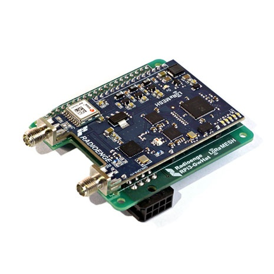</a>
</p>
<p align="center"><sub>Radioenge LoRaWAN Gateway, a placa principal (guia: <a href="Radioenge_LoRaWAN_Gateway.md"><code>Radioenge_LoRaWAN_Gateway.md</code></a>)</sub></p>

O firmware fala com o **SX1301** pela SPI, exatamente como o `lora_gateway` fazia no Raspberry Pi. Servem as placas concentradoras com SX1301 + 2× SX1257 (ou SX1255) que trazem o conector de 40 pinos do Raspberry Pi ou expõem os mesmos sinais: **Radioenge LoRaWAN Gateway** (RD43HAT / RD43HATGPS, a placa principal do projeto; guia próprio em [`Radioenge_LoRaWAN_Gateway.md`](Radioenge_LoRaWAN_Gateway.md)), **RAK2245 Pi HAT**, **RAK831 + adaptador**, **IMST iC880A** (por fios), **RisingHF RHF0M301** etc. Confira na documentação da sua placa em qual pino estão MOSI/MISO/SCLK/CS/RESET; a tabela usa a numeração do conector Raspberry Pi. Entre a Radioenge e a RAK2245 muda só o pino do RESET (26 na Radioenge, 11 na RAK2245).

Os dois S3 usam a **mesma pinagem**, porque o layout da DevKitC-1 é igual e nenhum pino usado depende da flash ou da PSRAM. O ESP32 clássico usa outra.

| Sinal | Conector RPi (pino) | `esp32` | `esp32s3_n16r8` | `esp32s3_n32r16v` |
|---|:---:|:---:|:---:|:---:|
| SPI MOSI | 19 | GPIO23 | GPIO11 | GPIO11 |
| SPI MISO | 21 | GPIO19 | GPIO13 | GPIO13 |
| SPI SCLK | 23 | GPIO18 | GPIO12 | GPIO12 |
| CS do SX1301 | 24 | GPIO5 | GPIO10 | GPIO10 |
| RESET do SX1301 (ativo alto) | **26 (Radioenge)** · 11 (RAK2245) · 22 (iC880A/RAK831 em alguns adaptadores) | GPIO4 | GPIO6 | GPIO6 |
| I2C SDA *(só OLED opcional)* | — | GPIO21 | GPIO4 | GPIO4 |
| I2C SCL *(só OLED opcional)* | — | GPIO22 | GPIO5 | GPIO5 |
| GPS RX da placa *(opcional)* | 8 | GPIO17 | GPIO17 | GPIO17 |
| GPS TX da placa *(opcional)* | 10 | GPIO16 | GPIO18 | GPIO18 |
| 5 V | 2 / 4 | 5V/VIN | 5V | 5V |
| GND | 6 | GND | GND | GND |
| Botão do Soft AP | — | GPIO0 (BOOT) | GPIO0 (BOOT) | GPIO0 (BOOT) |
| LED de status | — | GPIO2 | — (LED RGB) | — (LED RGB) |
| Controlador SPI | — | `SPI3_HOST` (VSPI) | `SPI2_HOST` (FSPI, IOMUX) | `SPI2_HOST` (FSPI, IOMUX) |

Particularidades do SX1301:

- **Um só chip select e nenhum sensor de temperatura:** o SX1301 não tem rádio de LBT/scan à parte, e a HAL do SX1301 não usa I2C. O I2C fica só para o OLED SSD1306 opcional.
- **PPS:** nas placas RAK2245/RAK831/iC880A o PPS do GPS já vai ao pino de PPS do SX1301 na própria placa, e o contador interno do SX1301 é travado nele. Por isso `CONFIG_GW_GPS_PPS_SX1301=y` (padrão). Não é preciso levar o PPS ao ESP32. Na Radioenge RD43HATGPS o *TimePulse* não sai no conector RPi; confirme na bancada que a referência de tempo fica válida ([guia da Radioenge](Radioenge_LoRaWAN_Gateway.md#5-gps-e-pps-rd43hatgps)).
- **POWER_EN:** placas que têm pino de habilitação do regulador podem usá-lo com `-D SX1301_POWER_EN_PIN=<gpio>`; o padrão é `GPIO_NUM_NC`.
- **Alimentação:** a Radioenge consome 300 mA recebendo e **700 mA** transmitindo (+27 dBm); a RAK2245/iC880A, até ~500 mA. Use uma fonte de 5 V / 2 A (com a Radioenge, sempre), e não alimente a placa pelo regulador de 3,3 V da DevKit.
- **SPI:** o `lora_gateway` usa 8 MHz (`SPI_SPEED` em `main/libloragw/loragw_spi.h`). Com fios longos (mais de 10 cm), baixe para 2–4 MHz.

### Conferindo as ligações

Se `lgw_start()` falhar, o firmware roda `sx1301_wiring_diag` antes de reiniciar (em 20 s). Ele:

1. lê o nível do MISO com CS alto e baixo, com pull-up e pull-down fracos, e diz se o SX1301 responde ao CS (MISO preso em 0 = módulo sem alimentação ou curto; ninguém dirige o MISO com CS baixo = fio do CS errado ou chip em reset);
2. tenta ler o registrador de versão (deve dar **103**, `0x67`) com as duas polaridades de reset e com SPI a 2 MHz e 500 kHz, e diz qual combinação funcionou;
3. mostra os níveis das linhas I2C/SPI.

Se a versão só aparece a 500 kHz, os fios estão longos ou mal encostados. Se só aparece com o reset ativo baixo, ou não aparece em nenhuma combinação, confira o pino do RESET no conector (26 na Radioenge, 11 na RAK2245) antes de concluir que a placa é diferente.

Onde fica no código: os blocos `if(IDF_TARGET STREQUAL ...)` de [`main/CMakeLists.txt`](../../main/CMakeLists.txt). Cada valor pode ser trocado com `-D`, por exemplo `idf.py ... -D PIN_NUM_CS=...`.

### GPIOs que não podem ser usados

| | `esp32` (WROOM-32U) | `esp32s3_n16r8` (WROOM-1U) | `esp32s3_n32r16v` (WROOM-2) |
|---|---|---|---|
| Memória flash | 6–11 | 26–32 | 26–32 |
| PSRAM | — | 35–37 (octal; 33/34 não saem no módulo) | 33–37 (flash/PSRAM octal) |
| Domínio de 1,8 V | — | — (47/48 são de 3,3 V) | **47, 48** |
| Console | 1, 3 (UART0) | 19, 20 (USB) · 43, 44 (UART0) | 19, 20 (USB) · 43, 44 (UART0) |
| Strapping | 0, 2, 5, 12, 15 (12 é o crítico) | 0, 3, 45, 46 | 0, 3, 45, 46 |
| Só entrada | 34–39 | — | — |
| **Livres** para expansão | 13, 14, 25, 26, 27, 32, 33 | 1, 2, 7, 8, 9, 14, 15, 16, 21, 38–42, 47, 48 | 1, 2, 7, 8, 9, 14, 15, 16, 21, 38–42 |

---

## 2. Arquivos de configuração por placa

O `CMakeLists.txt` da raiz traduz `BOARD` em `IDF_TARGET` e na lista de `SDKCONFIG_DEFAULTS`. Os arquivos são carregados nesta ordem (o último vence):

| Ordem | Arquivo | `esp32` | `esp32s3_n16r8` | `esp32s3_n32r16v` | Conteúdo |
|:---:|---|:---:|:---:|:---:|---|
| 1 | [`sdkconfig.defaults`](../../sdkconfig.defaults) | ✅ | ✅ | ✅ | Comum: HTTP, mbedTLS dinâmico, tabela de partições do ESP32 |
| 2 | [`sdkconfig.defaults.esp32`](../../sdkconfig.defaults.esp32) | ✅ | — | — | Menos buffers RX do Wi-Fi (RAM para o TLS) |
| 2 | [`sdkconfig.defaults.esp32s3`](../../sdkconfig.defaults.esp32s3) | — | ✅ | ✅ | Console no USB nativo, tabela de partições com app de 4 MB |
| 3 | [`boards/esp32.defaults`](../../boards/esp32.defaults) | ✅ | — | — | Flash 4 MB DIO 40 MHz, `CONFIG_GW_BOARD_ESP32_WROOM_32U` |
| 3 | [`boards/esp32s3_n16r8.defaults`](../../boards/esp32s3_n16r8.defaults) | — | ✅ | — | Flash 16 MB **QIO** 80 MHz, PSRAM **octal**, `CONFIG_GW_BOARD_ESP32S3_WROOM_1U_N16R8` |
| 3 | [`boards/esp32s3_n32r16v.defaults`](../../boards/esp32s3_n32r16v.defaults) | — | — | ✅ | Flash 32 MB **octal (OPI)** 80 MHz, PSRAM **octal**, `CONFIG_GW_BOARD_ESP32S3_WROOM_2_N32R16V` |
| — | [`partitions_esp32s3.csv`](../../partitions_esp32s3.csv) | — | ✅ | ✅ | `nvs` 0x9000, `phy_init` 0xF000, `factory` 0x10000 com **4 MB** |
| — | [`main/Kconfig.projbuild`](../../main/Kconfig.projbuild) | ✅ | ✅ | ✅ | Escolha `GW_BOARD`, `GW_BOARD_ID`, `GW_BOARD_NAME`, `GW_MDNS` |
| — | [`main/CMakeLists.txt`](../../main/CMakeLists.txt) | ✅ | ✅ | ✅ | Pinagem por alvo e conferência `BOARD` × sdkconfig |

### Opções que mudam entre as placas (resultado no `sdkconfig.<board>`)

| Opção | `esp32` | `esp32s3_n16r8` | `esp32s3_n32r16v` |
|---|---|---|---|
| `CONFIG_IDF_TARGET` | `esp32` | `esp32s3` | `esp32s3` |
| `CONFIG_GW_BOARD_*` | `ESP32_WROOM_32U` | `ESP32S3_WROOM_1U_N16R8` | `ESP32S3_WROOM_2_N32R16V` |
| `CONFIG_ESPTOOLPY_FLASHMODE_*` | `DIO` | `QIO` | — (`OCT_FLASH=y` → OPI) |
| `CONFIG_ESPTOOLPY_OCT_FLASH` | — | — | `y` |
| `CONFIG_ESPTOOLPY_FLASHFREQ_*` | `40M` | `80M` | `80M` |
| `CONFIG_ESPTOOLPY_FLASHSIZE_*` | `4MB` | `16MB` | `32MB` |
| `CONFIG_SPIRAM` | — | `y` | `y` |
| `CONFIG_SPIRAM_MODE_OCT` | — | `y` | `y` |
| `CONFIG_SPIRAM_SPEED_80M` / `USE_MALLOC` | — | `y` / `y` | `y` / `y` |
| `CONFIG_ESP_CONSOLE_*` | `UART_DEFAULT` | `USB_SERIAL_JTAG` | `USB_SERIAL_JTAG` |
| Tabela de partições | `partitions_singleapp_large.csv` (app 1,5 MB) | `partitions_esp32s3.csv` (app 4 MB) | `partitions_esp32s3.csv` (app 4 MB) |
| `CONFIG_ESP_WIFI_STATIC_RX_BUFFER_NUM` | `6` | padrão (10) | padrão (10) |
| `CONFIG_GW_MDNS` | não existe | `y` | `y` |
| Componente `espressif/mdns` | não baixado | baixado | baixado |

> O `esptool` grava `--flash_mode dio` no cabeçalho do N16R8 mesmo com QIO: no S3 o bootloader liga o modo QIO sozinho. No N32R16V aparece `dout`, que é o esperado para flash octal.

---

## 3. Compilar, gravar e monitorar

Com o ESP-IDF ativado (`. $IDF_PATH/export.sh`):

```bash
./scripts/build.sh esp32                              # ESP32-WROOM-32U
./scripts/build.sh esp32s3_n16r8                      # ESP32-S3-WROOM-1U-N16R8
./scripts/build.sh esp32s3_n32r16v                    # ESP32-S3-WROOM-2-N32R16V
./scripts/build.sh all                                # as três, em sequência

./scripts/build.sh esp32           flash /dev/ttyUSB0 # grava e abre o monitor
./scripts/build.sh esp32s3_n16r8   flash /dev/ttyACM0 # S3: porta "USB" (nativa), não a "UART"
./scripts/build.sh esp32s3_n32r16v flash /dev/ttyACM0

./scripts/build.sh esp32s3_n16r8 monitor /dev/ttyACM0 # só o monitor
./scripts/build.sh esp32s3_n16r8 erase   /dev/ttyACM0 # apaga a flash inteira (volta ao padrão de fábrica)
```

Os comandos completos de cada placa (liberar a porta com `fuser`, ativar o ESP-IDF e salvar a saída em `logs/`), nas variantes **Do zero** (apaga a flash), **Atualizar** (mantém a configuração) e **Só monitorar**, estão em [Gravar e acompanhar o log](../../README.md#gravar-e-acompanhar-o-log) do README e no documento de cada placa: [ESP32-WROOM-32U](ESP32-WROOM-32U_DevKit.md), [ESP32-S3-WROOM-1U-N16R8](ESP32-S3-WROOM-1U_N16R8_DevKit.md), [ESP32-S3-WROOM-2-N32R16V](ESP32-S3-WROOM-2_N32R16V_DevKit.md).

Cada placa tem a própria pasta de build e o próprio `sdkconfig`. Uma placa nunca sobrescreve a outra:

| `BOARD` | Pasta de build | sdkconfig gerado |
|---|---|---|
| `esp32` | `build-esp32/` | `sdkconfig.esp32` |
| `esp32s3_n16r8` | `build-esp32s3_n16r8/` | `sdkconfig.esp32s3_n16r8` |
| `esp32s3_n32r16v` | `build-esp32s3_n32r16v/` | `sdkconfig.esp32s3_n32r16v` |

O `build.sh` mostra a linha do `idf.py` que ele usa. No Windows nativo (PowerShell), rode essa linha direto:

```powershell
idf.py -B build-esp32           -D SDKCONFIG=sdkconfig.esp32           -D IDF_TARGET=esp32   -D BOARD=esp32           build
idf.py -B build-esp32s3_n16r8   -D SDKCONFIG=sdkconfig.esp32s3_n16r8   -D IDF_TARGET=esp32s3 -D BOARD=esp32s3_n16r8   build
idf.py -B build-esp32s3_n32r16v -D SDKCONFIG=sdkconfig.esp32s3_n32r16v -D IDF_TARGET=esp32s3 -D BOARD=esp32s3_n32r16v build
# gravar: troque "build" por "-p COM6 flash monitor"
```

> `./scripts/build.sh esp32s3` também é aceito e vira `esp32s3_n32r16v` (o script avisa).
>
> **Se aparecer** `BOARD=... but sdkconfig has board ...`, o `sdkconfig.<board>` é de outra placa (por exemplo, copiado à mão). Apague esse arquivo e a pasta `build-<board>/` e compile de novo.

---

## 4. Binários prontos (GitHub Actions / Releases)

O workflow [`build.yml`](../../.github/workflows/build.yml) compila as três placas a cada push e publica os binários nas tags `v*`:

| Arquivo | Uso |
|---|---|
| `Gateway_ESP32_SX1301_RD43HATGPS_Radioenge-<versão>-<BOARD>-full.bin` | imagem única, gravar em `0x0` (apaga a configuração) |
| `Gateway_ESP32_SX1301_RD43HATGPS_Radioenge-<versão>-<BOARD>-app.bin` | só a aplicação, gravar em `0x10000` (mantém a configuração) |
| `Gateway_ESP32_SX1301_RD43HATGPS_Radioenge-<versão>-<BOARD>-parts.zip` | bootloader, partições e app separados, com `flash_args` |

```bash
esptool.py --chip esp32   -p /dev/ttyUSB0 write_flash 0x0 Gateway_ESP32_SX1301_RD43HATGPS_Radioenge-<versão>-esp32-full.bin
esptool.py --chip esp32s3 -p /dev/ttyACM0 write_flash 0x0 Gateway_ESP32_SX1301_RD43HATGPS_Radioenge-<versão>-esp32s3_n16r8-full.bin
esptool.py --chip esp32s3 -p /dev/ttyACM0 write_flash 0x0 Gateway_ESP32_SX1301_RD43HATGPS_Radioenge-<versão>-esp32s3_n32r16v-full.bin
```

> Na primeira gravação use a imagem `-full.bin` (ou o `-parts.zip`). Depois disso, as atualizações podem ser só do `-app.bin`, que mantém a configuração.

---

## 5. Como o firmware informa a placa

| Onde | Exemplo |
|---|---|
| Boot (monitor serial) | `*** Board: ESP32-S3-WROOM-1U-N16R8 (esp32s3_n16r8, esp32s3) ***` |
| `GET /info` (sem login) | `"target":"esp32s3","board":"esp32s3_n16r8","board_name":"ESP32-S3-WROOM-1U-N16R8"` |
| `GET /config.json` | `"_target"`, `"_board"`, `"_board_name"` |
| mDNS (TXT do `_http._tcp`) | `board=esp32s3_n16r8` |
| App Android | Manutenção → **Placa**: nome do módulo e `BOARD` |

## Diagramas de ligação em alta resolução (Radioenge)

Cada placa tem o próprio guia de ligação (tabela, pinout, conector de 40 pinos de cima e de baixo, diagrama bloco a bloco, módulo de 14 vias, alimentação e conferência): [ESP32-WROOM-32U](ESP32-WROOM-32U_DevKit.md) · [ESP32-S3-WROOM-1U-N16R8](ESP32-S3-WROOM-1U_N16R8_DevKit.md) · [ESP32-S3-WROOM-2-N32R16V](ESP32-S3-WROOM-2_N32R16V_DevKit.md).

Clique na imagem para abrir o PNG de 3720 px. Cada um tem a versão vetorial (SVG) ao lado. Com a RAK2245, os fios são os mesmos, exceto o RESET (pino 11 em vez do 26).

| ESP32-WROOM-32U (`esp32`) | ESP32-S3-WROOM-1U-N16R8 (`esp32s3_n16r8`) | ESP32-S3-WROOM-2-N32R16V (`esp32s3_n32r16v`) |
|:---:|:---:|:---:|
| [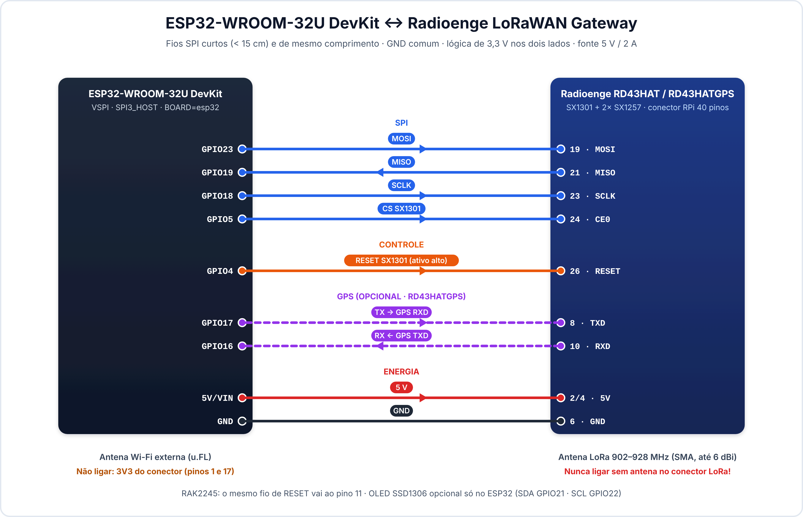](../images/wiring_esp32_wroom32u.png) | [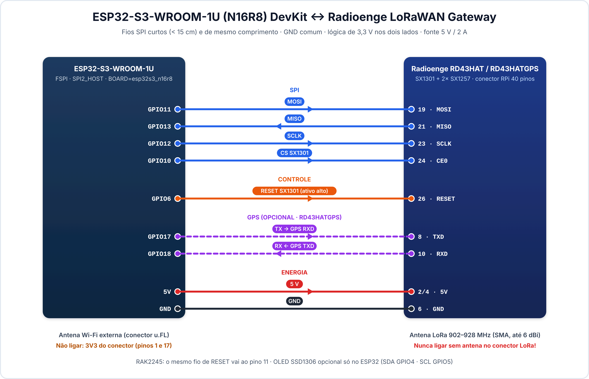](../images/wiring_esp32s3_wroom1u_n16r8.png) | [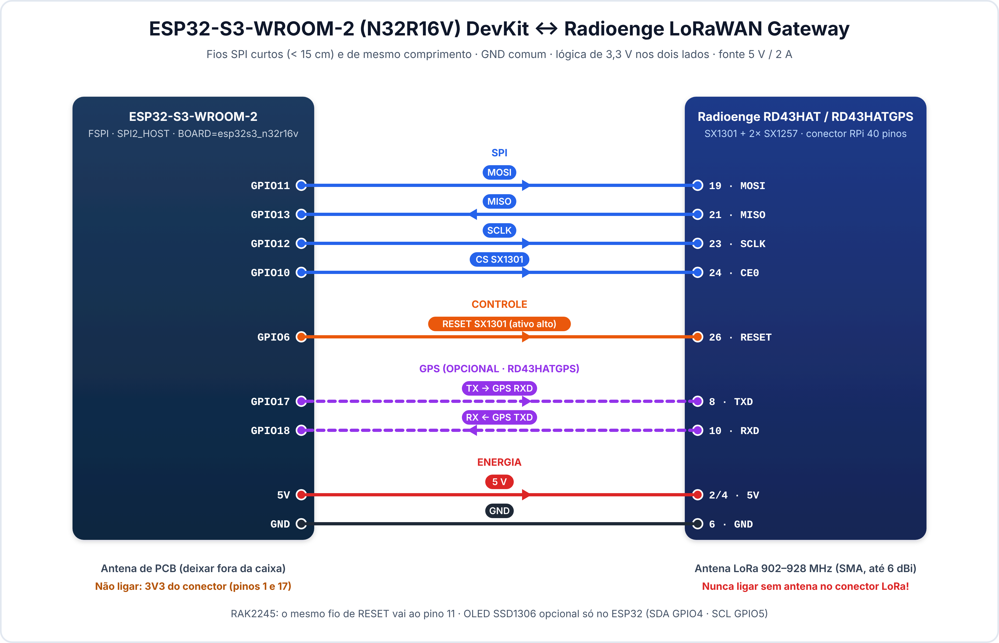](../images/wiring_esp32s3_wroom2.png) |
| [SVG](../images/wiring_esp32_wroom32u.svg) | [SVG](../images/wiring_esp32s3_wroom1u_n16r8.svg) | [SVG](../images/wiring_esp32s3_wroom2.svg) |

<p align="center">
  <a href="../images/radioenge_header.png">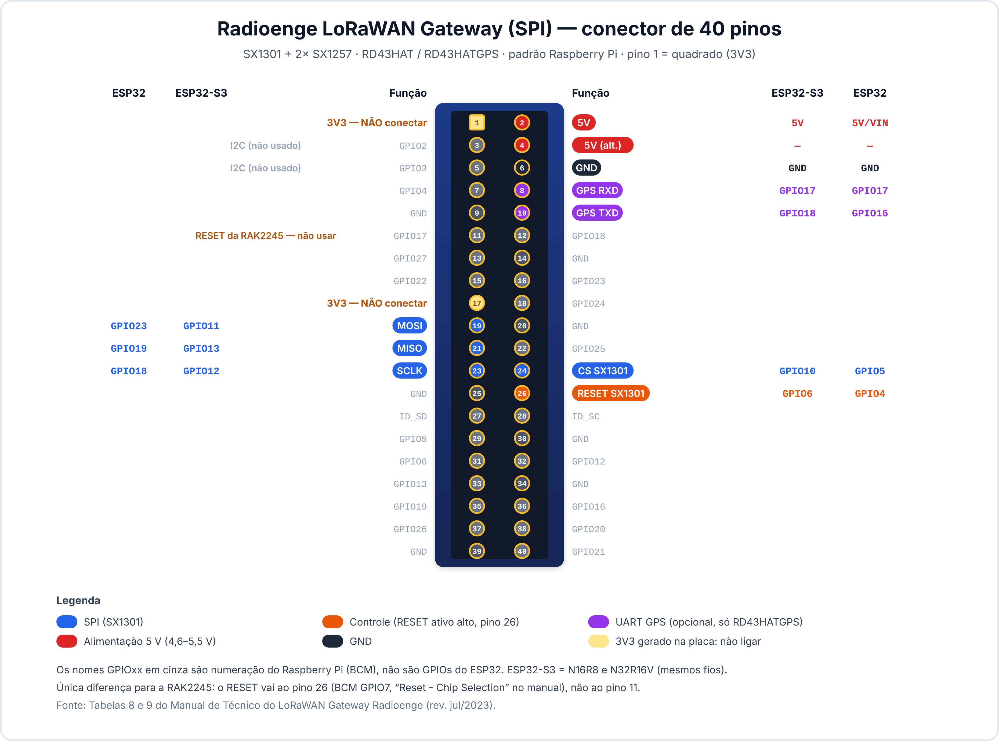</a>
</p>
<p align="center"><sub>🔍 Alta resolução (PNG, 3720 px de largura): clique na imagem para ampliar · versão vetorial: <a href="../images/radioenge_header.svg"><code>radioenge_header.svg</code></a></sub></p>

> ⚠️ **Os jumpers entram por baixo do shield, e por baixo as fileiras trocam de lado.** O conector fêmea fica sob a placa: olhando por baixo, o pino 2 aparece à **esquerda** do pino 1. Contar os pinos por baixo usando a vista de cima põe cada fio na fileira errada (o 5 V cai no pino 1, de 3V3, e o módulo fica sem alimentação). No log isso aparece como `NOT EXPECTED CHIP VERSION (v0)` e `MISO is held LOW even with the SX1301 deselected`. **Antes de ligar**, com tudo desligado e o multímetro no bip: a carcaça dos SMA é GND, e os pinos 6, 9, 14, 20 e 25 têm que apitar com ela.

Conector de 40 pinos com os GPIOs de cada placa (vista de cima):

| ESP32-WROOM-32U (`esp32`) | ESP32-S3-WROOM-1U-N16R8 (`esp32s3_n16r8`) | ESP32-S3-WROOM-2-N32R16V (`esp32s3_n32r16v`) |
|:---:|:---:|:---:|
| [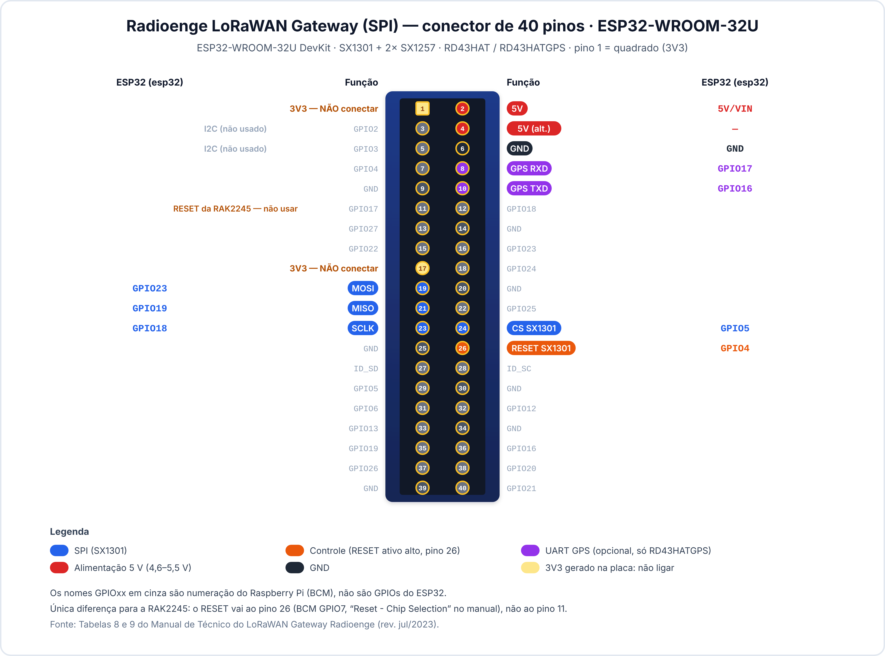](../images/radioenge_header_esp32.png) | [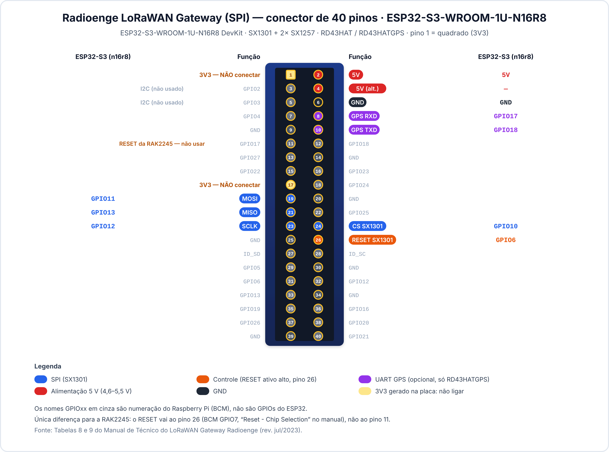](../images/radioenge_header_esp32s3_n16r8.png) | [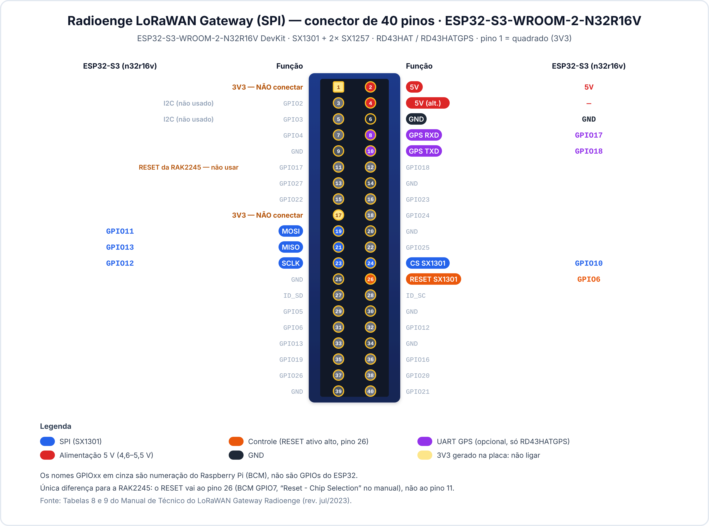](../images/radioenge_header_esp32s3_n32r16v.png) |
| [SVG](../images/radioenge_header_esp32.svg) | [SVG](../images/radioenge_header_esp32s3_n16r8.svg) | [SVG](../images/radioenge_header_esp32s3_n32r16v.svg) |

Visto de cima e de baixo (por onde entram os jumpers):

| ESP32-WROOM-32U (`esp32`) | ESP32-S3-WROOM-1U-N16R8 (`esp32s3_n16r8`) | ESP32-S3-WROOM-2-N32R16V (`esp32s3_n32r16v`) |
|:---:|:---:|:---:|
| [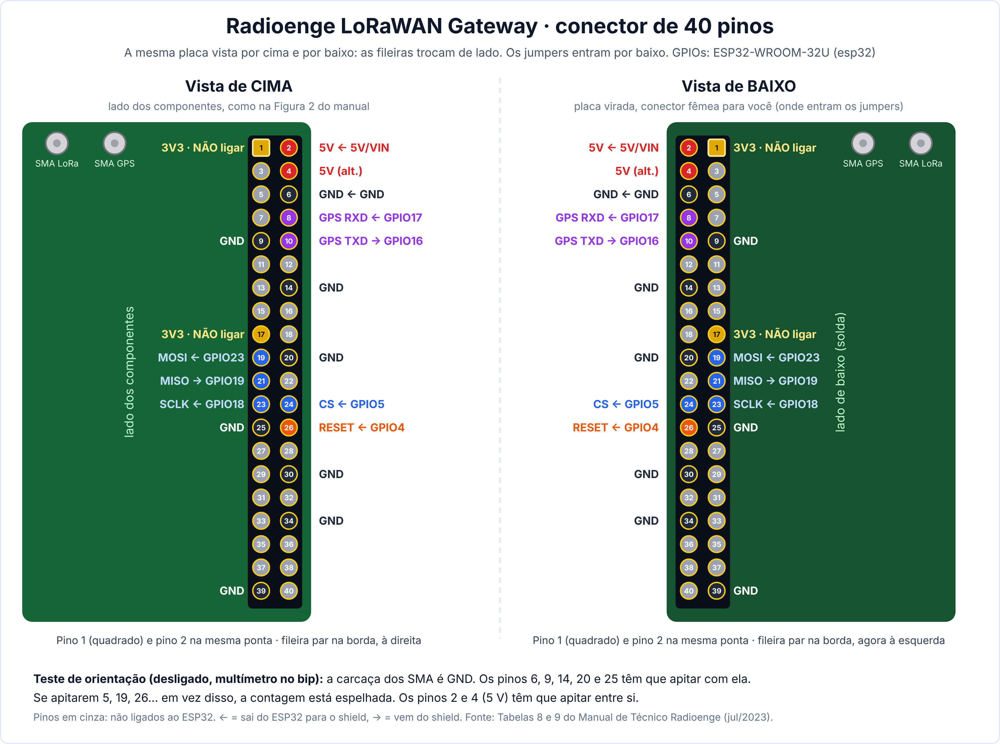](../images/radioenge_header_cima_baixo_esp32.png) | [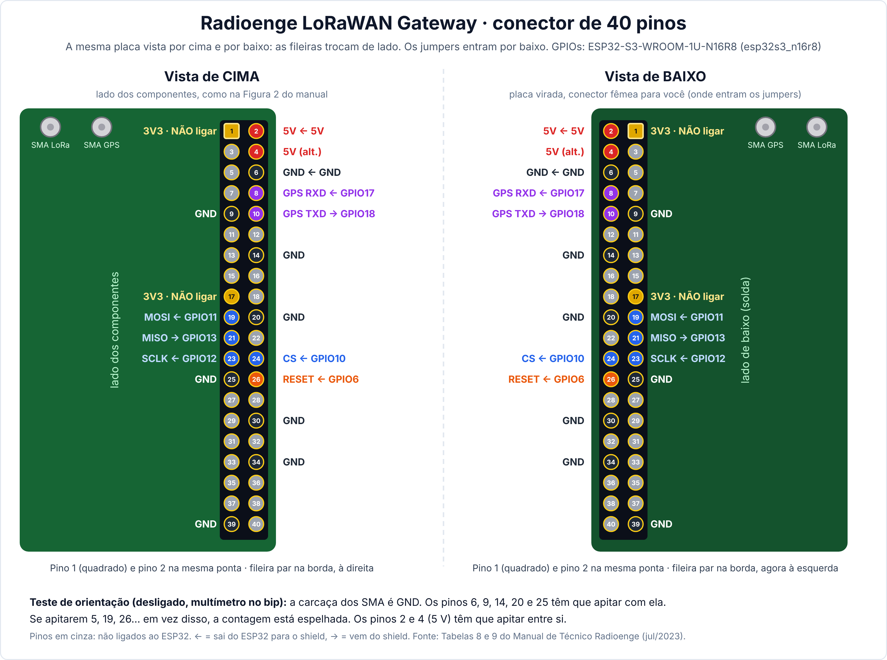](../images/radioenge_header_cima_baixo_esp32s3_n16r8.png) | [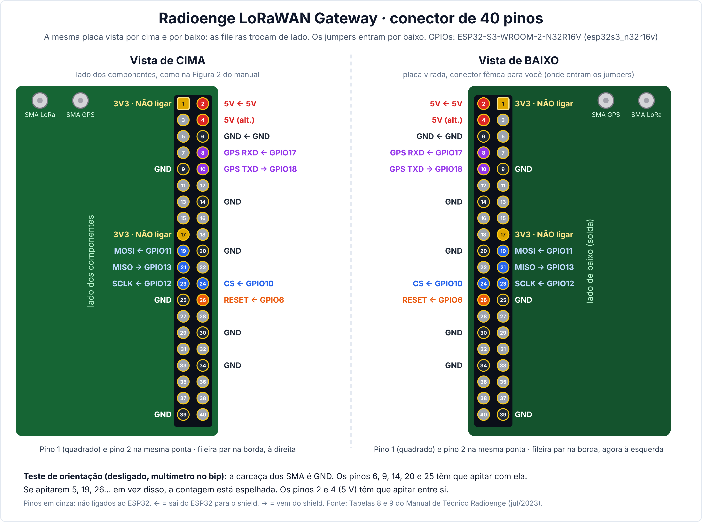](../images/radioenge_header_cima_baixo_esp32s3_n32r16v.png) |
| [SVG](../images/radioenge_header_cima_baixo_esp32.svg) | [SVG](../images/radioenge_header_cima_baixo_esp32s3_n16r8.svg) | [SVG](../images/radioenge_header_cima_baixo_esp32s3_n32r16v.svg) |
