# Radioenge LoRaWAN Gateway (RD43HAT / RD43HATGPS): concentrador principal do projeto

O **LoRaWAN Gateway da Radioenge** é um *shield* brasileiro, homologado pela ANATEL (**02053-18-07215**), com o concentrador **Semtech SX1301** de 8 canais. A Radioenge o vende para encaixar num Raspberry Pi 3 e rodar o *packet forwarder* da Semtech. Neste projeto, o Raspberry Pi sai e o **ESP32 fala direto com o SX1301 pela SPI**. Por isso a Radioenge é a placa principal do ESP32_SX1301.

| Item | Valor |
|---|---|
| Modelos | **RD43HAT** (sem GPS) e **RD43HATGPS** (com GPS) |
| Concentrador | Semtech **SX1301**, 8 canais simultâneos (recepção) |
| Faixa | 902–928 MHz, TDD (half-duplex) |
| RX / TX | **902,5–907 MHz e 915–928 MHz** (a faixa 907,5–915 MHz não é usada no Brasil) |
| Largura de banda | 125 / 250 / 500 kHz, LoRa/CSS |
| Potência máxima | **+27 dBm (0,5 W)** |
| Sensibilidade | −137 dBm (BER 0,1 %) |
| Nível máximo de entrada | −20 dBm (normal) / 0 dBm (máximo) |
| Conectores RF | SMA (LoRa) e SMA (GPS, só no RD43HATGPS) |
| Alimentação | **5 V** (4,6–5,5 V), **300 mA** em recepção, **700 mA** em transmissão; fonte de 5 V / 1 A no mínimo |
| Interface | SPI 3,3 V (SX1301) + UART 3,3 V (GPS) |
| Temperatura de operação | −5 °C a +55 °C |
| Antena | 902–928 MHz, SMA-macho, ganho máximo **6 dBi** (Ato ANATEL nº 14448/2017) |
| Documentação | [página do produto](https://www.radioenge.com.br/en/product/lorawan-gateway/) · [Manual de Técnico (rev. jul/2023)](https://www.radioenge.com.br/wp-content/uploads/2021/08/Manual_LoRaWAN_Gateway_jul_2023.pdf) · [manual técnico rev4](https://www.radioenge.com.br/wp-content/uploads/2021/08/manual-tecnico-lorameshgateway-rev4.pdf) |

| <a href="../images/radioenge/radioenge_hat_foto.jpg">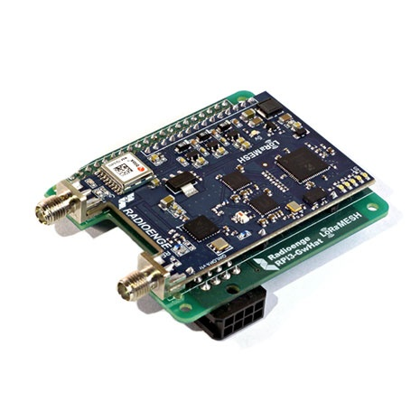</a> | <a href="../images/radioenge/radioenge_fig2_vista_superior.jpg">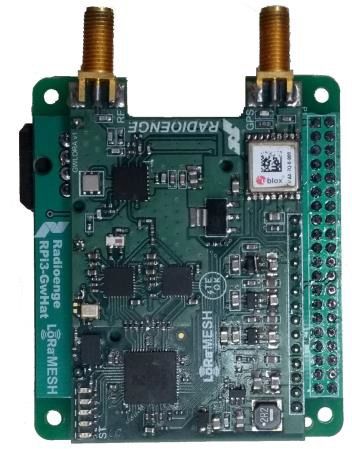</a> |
|:---:|:---:|
| Radioenge LoRaWAN Gateway (RPI3-GwHat LoRaMESH): shield com o módulo GWLORA v1, SMA de LoRa e de GPS | Vista superior (Figura 2 do manual): conector de 40 pinos à direita, u-blox do GPS no alto |

> ⚠️ **Nunca ligue a placa sem antena no conector LoRa.** O manual da Radioenge avisa que isso danifica o módulo e não é coberto pela garantia.

---

## 0. A placa nas imagens do manual

As figuras abaixo são do Manual de Técnico do LoRaWAN Gateway Radioenge, rev. jul/2023. Elas mostram a placa como a Radioenge a entrega, para encaixar num Raspberry Pi 3. Neste projeto, o **ESP32 ocupa o lugar do Raspberry Pi**: os mesmos sinais do conector de 40 pinos vão por fios curtos até a DevKit, e o *packet forwarder* roda no próprio ESP32 (seção 2).

| <a href="../images/radioenge/radioenge_fig6_shield.jpg">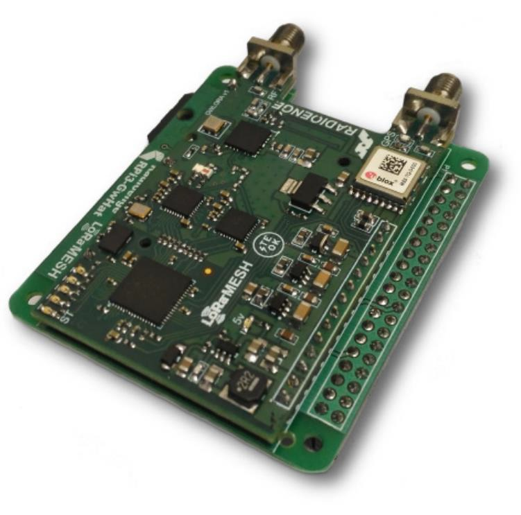</a> | <a href="../images/radioenge/radioenge_fig7_shield_rpi3.jpg">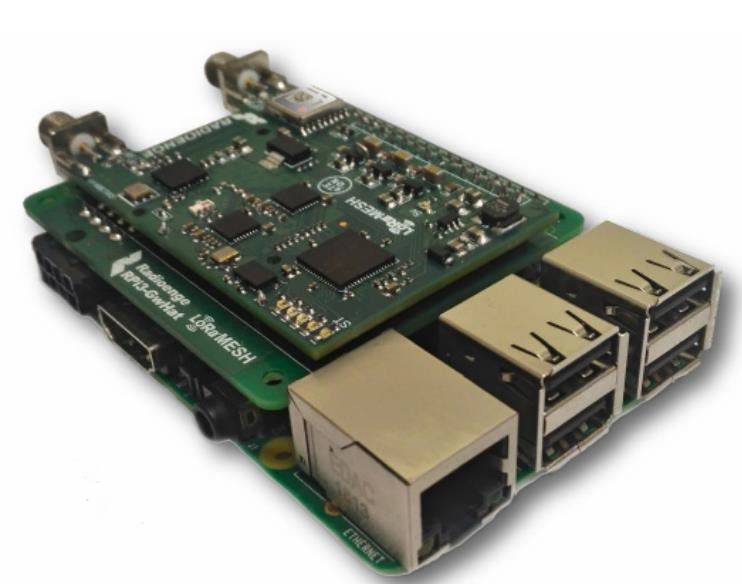</a> |
|:---:|:---:|
| Figura 6: o gateway como a Radioenge fornece (shield RPI3-GwHat + módulo GWLORA) | Figura 7: no Raspberry Pi 3, uso original. Aqui o Pi é trocado pelo ESP32 |

<p align="center">
  <a href="../images/radioenge/radioenge_fig1_topologia.png">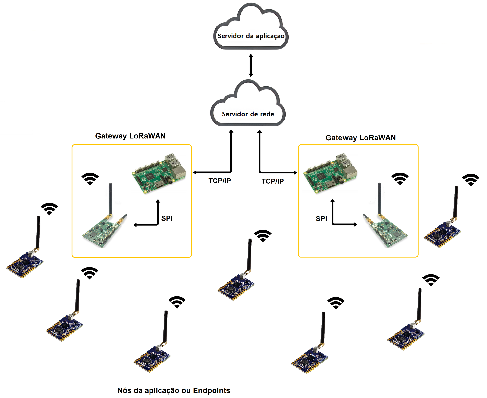</a>
</p>
<p align="center"><sub>Figura 1 do manual: topologia em estrela. Nós → gateway (8 canais) → servidor de rede → aplicação. No ESP32_SX1301, o bloco “Raspberry Pi + SPI” vira “ESP32 + SPI”, e o servidor de rede é o ChirpStack.</sub></p>

### 0.1 A rede toda com equipamentos Radioenge: este gateway + o EndDevice LoRaWAN

Do lado dos nós, a Radioenge tem o **Módulo LoRaWAN EndDevice** (STM32L071CZT6 + SX1272, ANATEL 02021-18-07215). Ele é configurado por comandos AT (`AT+JOIN`, `AT+SEND`, `AT+CHMASK`, `AT+GPIOC`, `AT+KEEPALIVE`...) e fala com este gateway como qualquer outro nó LoRaWAN AU915.

| <a href="../images/radioenge/radioenge_rede_lorawan_topologia.png">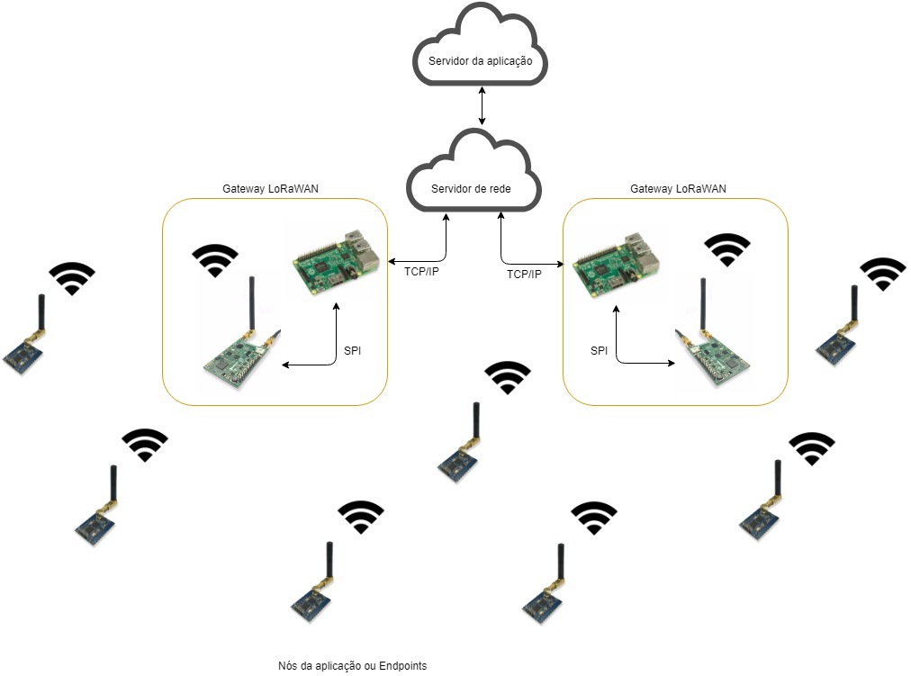</a> | <a href="../images/radioenge/radioenge_enddevice_foto.png">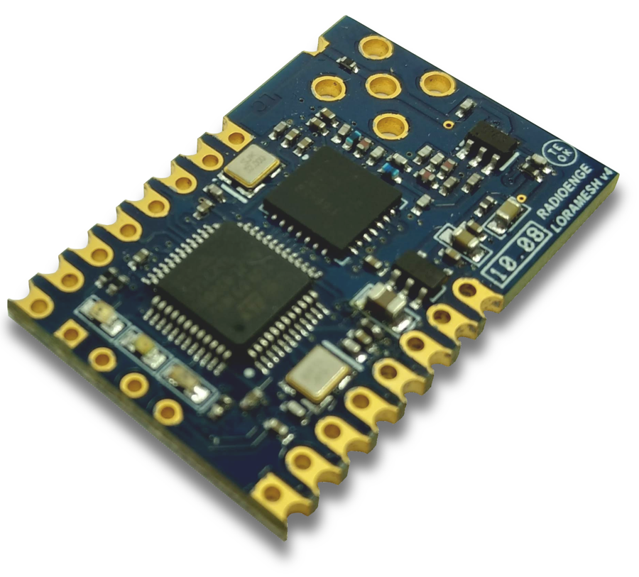</a> |
|:---:|:---:|
| Rede LoRaWAN Radioenge (manual do Mote LoRa, rev. ago/2019): EndDevices → gateways → servidor de rede → servidor de aplicação | Módulo LoRaWAN EndDevice Radioenge, o nó usado com este gateway |

Para a rede inteira funcionar com o plano deste gateway (AU915, sub-banda 1 = canais 8–15 + 65), o nó precisa da mesma máscara de canais: no EndDevice Radioenge, `AT+CHMASK=ff00:0000:0000:0000:0002:0000` (canais 8–15 + canal 65 de 500 kHz).

---

## 1. Conferência do firmware para esta placa

O firmware **funciona com a Radioenge sem mudar código**. O que a placa exige e o que o firmware faz:

| O que a Radioenge exige | O que o firmware faz | Situação |
|---|---|:---:|
| SX1301 pela SPI (protocolo Semtech, *packet forwarder*) | HAL `lora_gateway` v5.0.1 portada, SPI a 8 MHz, modo 0 | ✅ |
| CS no pino 24 do conector (SPI0 CE0) | CS = GPIO5 (ESP32) / GPIO10 (S3), fio no pino 24 | ✅ |
| RESET no pino **26** do conector (BCM GPIO7) | RESET = GPIO4 (ESP32) / GPIO6 (S3), **só o fio muda** (pino 26 em vez do 11 da RAK2245) | ✅ fio |
| Pulso de reset ativo em nível alto (o mesmo do `reset_lgw.sh` com `reset_pin=7`) | `lgw_reset()`: nível 1 por 100 ms e volta a 0 | ✅ |
| Rádios SX1257 de 915 MHz, `clksrc` 1 | planos AU915/US915 com `"type": "SX1257"`, `clksrc` 1 | ✅ (conferir em bancada) |
| TX até +27 dBm | `tx_lut_15` = 27 dBm | ✅ (medir a potência real) |
| TX só em 915–928 MHz no Brasil | AU915: `tx_freq_min` 915 MHz, `tx_freq_max` 928 MHz; downlinks em 923,3–927,5 MHz | ✅ |
| GPS na UART (pinos 8/10 do conector) | UART1 a 9600 baud, liga/desliga pela página | ✅ |
| PPS (*TimePulse*) do GPS | `CONFIG_GW_GPS_PPS_SX1301=y`: espera o PPS já no SX1301, dentro da placa | ⚠️ conferir (seção 5) |
| Sem POWER_EN, sem SX1261, sem sensor de temperatura | `SX1301_POWER_EN_PIN=GPIO_NUM_NC`, status "sem sensor" | ✅ |
| 5 V / 700 mA no TX | só alimentação: fonte externa de 5 V / 2 A (seção 4) | ⚠️ hardware |

Os parâmetros do plano que dependem da placa (`clksrc`, `rssi_offset`, `tx_notch_freq` e a tabela `tx_lut_0..15`) estão com os valores da Semtech para o projeto de referência do SX1301 (PCB_E286, também usados por RAK2245/RAK831/iC880A). A Radioenge não os publica no manual. Eles ficam no `global_conf_AU915.json` da imagem do cartão SD da Radioenge (`Radioenge_LoRaGW_V4.zip`, pasta `/opt/LoRa/packet_forwarder/lora_pkt_fwd/`). Se algum valor for diferente, copie-o para [`main/packet_forwarder/global_conf.json/global_conf.au915_sb1.json`](../../main/packet_forwarder/global_conf.json/global_conf.au915_sb1.json) (e para o `au915_sb0`) e compile de novo.

---

## 2. Ligações ESP32 ↔ Radioenge (conector de 40 pinos do Raspberry Pi)

É a numeração do conector fêmea do shield (a mesma do Raspberry Pi; pino 1 = canto do quadrado, "3V3"). Tabela 9 do manual da Radioenge:

<p align="center">
  <a href="../images/radioenge_header.png">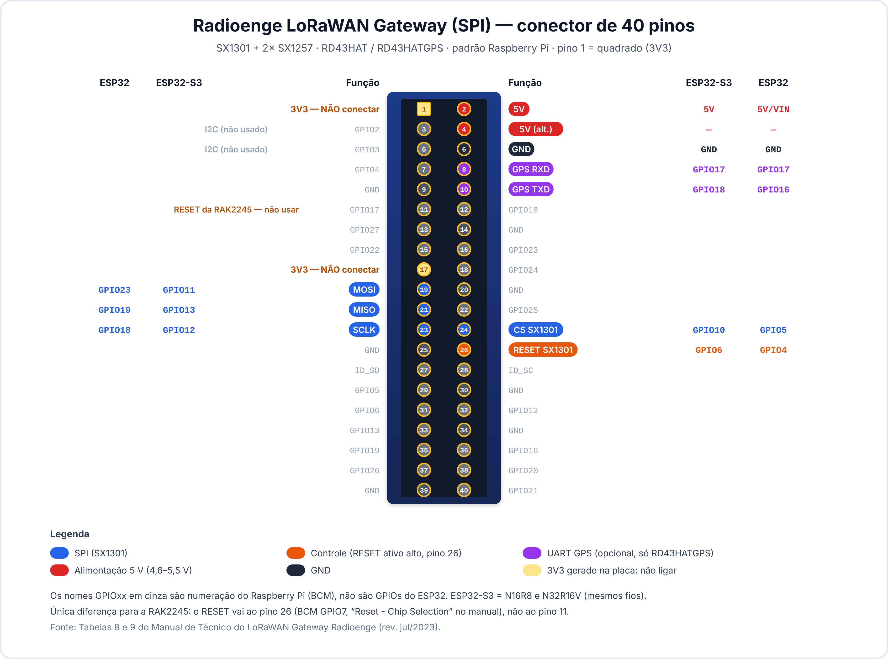</a>
</p>
<p align="center"><sub>🔍 Alta resolução (PNG, 3720 px de largura): clique na imagem para ampliar · versão vetorial: <a href="../images/radioenge_header.svg"><code>radioenge_header.svg</code></a></sub></p>

| Sinal | Pino do módulo (14 vias) | Pino do conector RPi | `esp32` | S3 (`n16r8` / `n32r16v`) |
|---|:---:|:---:|:---:|:---:|
| GND | 1 / 2 | **6** (ou 9, 14, 20, 25, 30, 34, 39) | GND | GND |
| +5 V | 3 / 4 | **2** ou **4** | 5V / VIN (ou fonte externa) | 5V (ou fonte externa) |
| **RESET** do SX1301 (ativo alto) | 5 | **26** | **GPIO4** | **GPIO6** |
| SCK | 6 | **23** | GPIO18 | GPIO12 |
| MISO | 7 | **21** | GPIO19 | GPIO13 |
| MOSI | 8 | **19** | GPIO23 | GPIO11 |
| CS (CSN) | 9 | **24** | GPIO5 | GPIO10 |
| GPS RXD ← TX do ESP32 *(RD43HATGPS)* | 13 | **8** | GPIO17 | GPIO17 |
| GPS TXD → RX do ESP32 *(RD43HATGPS)* | 14 | **10** | GPIO16 | GPIO18 |
| TimePulse (PPS) | 11 | — (não vai ao conector) | — | — |
| GPSRESET | 12 | — (não vai ao conector) | — | — |

```
          Radioenge LoRaWAN Gateway: conector de 40 pinos (vista de cima)

              3V3  1 ● ● 2   5V    ◄── 5 V
                   3 ● ● 4   5V    ◄── 5 V (ou o pino 2)
                   5 ● ● 6   GND   ◄── GND
                   7 ● ● 8   TXD   ──► GPS RXD   (ESP32 GPIO17 / S3 GPIO17)  [RD43HATGPS]
              GND  9 ● ● 10  RXD   ◄── GPS TXD   (ESP32 GPIO16 / S3 GPIO18)  [RD43HATGPS]
                  11 ● ● 12              (pino 11 = RESET da RAK2245: NÃO usar na Radioenge)
                  13 ● ● 14  GND
                  15 ● ● 16
              3V3 17 ● ● 18
   MOSI ──► 19 ● ● 20  GND           (ESP32 GPIO23 / S3 GPIO11)
   MISO ◄── 21 ● ● 22                (ESP32 GPIO19 / S3 GPIO13)
   SCLK ──► 23 ● ● 24  CE0 ◄── CS    (SCLK: GPIO18 / GPIO12 · CS: GPIO5 / GPIO10)
              GND 25 ● ● 26  ◄── RESET do SX1301 (ESP32 GPIO4 / S3 GPIO6)
```

- **A única diferença para a RAK2245 é o RESET: pino 26, não 11.** No Raspberry Pi esse pino é o SPI0 CE1 (BCM GPIO7), por isso o manual o chama de "Reset - Chip Selection". No ESP32 ele é só um GPIO de saída.
- **Não ligue os 3V3 do conector (pinos 1 e 17).** A placa gera os 3,3 V a partir dos 5 V.
- A lógica é de 3,3 V, igual à do ESP32: não precisa de conversor de nível.
- Fios SPI curtos (< 15 cm). Com fios longos, baixe o `SPI_SPEED` em `main/libloragw/loragw_spi.h` para 2–4 MHz.
- Ligação detalhada de cada placa (seção 2.0): [ESP32-WROOM-32U](ESP32-WROOM-32U_DevKit.md), [ESP32-S3-WROOM-1U-N16R8](ESP32-S3-WROOM-1U_N16R8_DevKit.md) e [ESP32-S3-WROOM-2-N32R16V](ESP32-S3-WROOM-2_N32R16V_DevKit.md).

### Vista de cima × vista de baixo: confira antes de ligar os fios

> ⚠️ **Os jumpers entram por baixo do shield, e por baixo as fileiras trocam de lado.** O conector fêmea fica sob a placa: olhando por baixo, o pino 2 aparece à **esquerda** do pino 1. Contar os pinos por baixo usando a vista de cima põe cada fio na fileira errada (o 5 V cai no pino 1, de 3V3, e o módulo fica sem alimentação). No log isso aparece como `NOT EXPECTED CHIP VERSION (v0)` e `MISO is held LOW even with the SX1301 deselected`. **Antes de ligar**, com tudo desligado e o multímetro no bip: a carcaça dos SMA é GND, e os pinos 6, 9, 14, 20 e 25 têm que apitar com ela.

#### ESP32-WROOM-32U (`esp32`)

<p align="center">
  <a href="../images/radioenge_header_cima_baixo_esp32.png">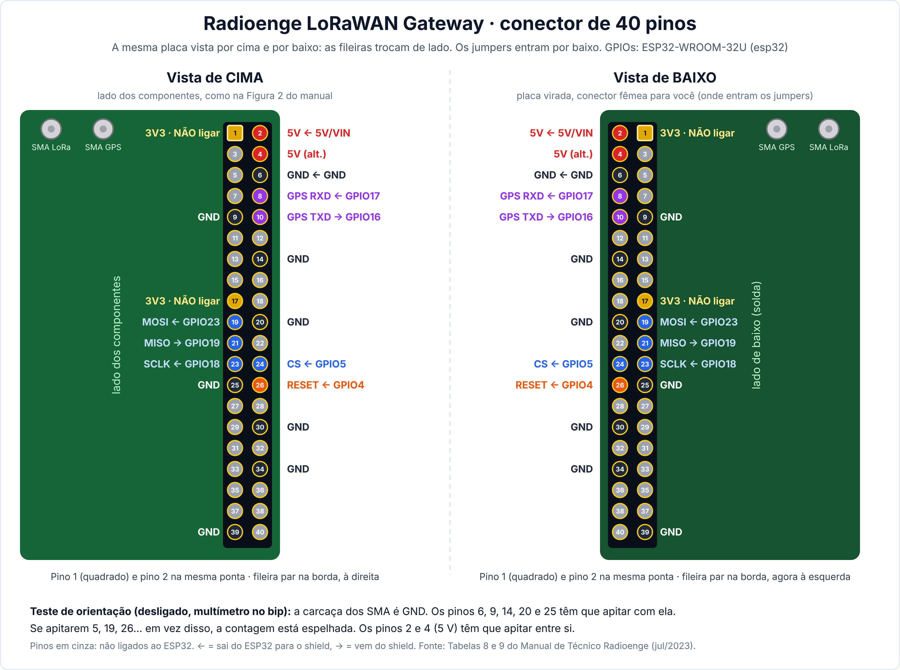</a>
</p>
<p align="center"><sub>🔍 Alta resolução (PNG, 3600 px de largura): clique na imagem para ampliar · versão vetorial: <a href="../images/radioenge_header_cima_baixo_esp32.svg"><code>radioenge_header_cima_baixo_esp32.svg</code></a></sub></p>

#### ESP32-S3-WROOM-1U-N16R8 (`esp32s3_n16r8`)

<p align="center">
  <a href="../images/radioenge_header_cima_baixo_esp32s3_n16r8.png">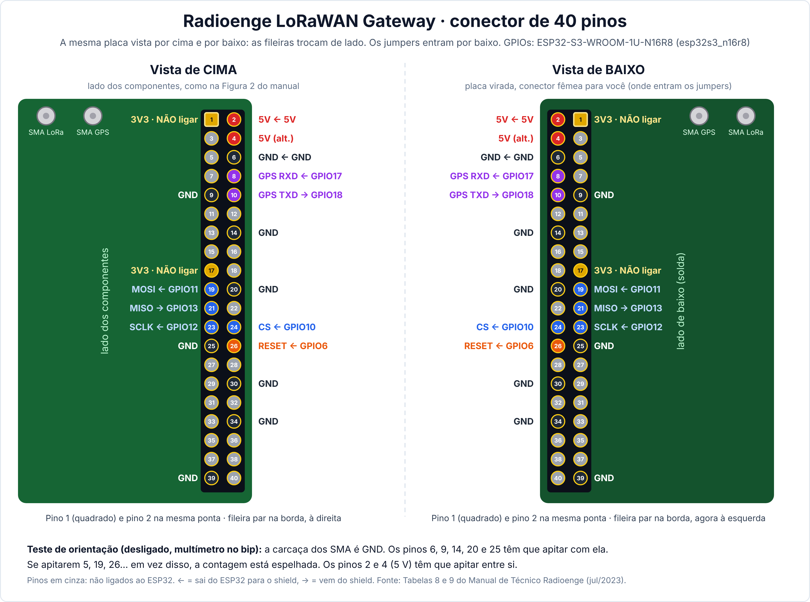</a>
</p>
<p align="center"><sub>🔍 Alta resolução (PNG, 3600 px de largura): clique na imagem para ampliar · versão vetorial: <a href="../images/radioenge_header_cima_baixo_esp32s3_n16r8.svg"><code>radioenge_header_cima_baixo_esp32s3_n16r8.svg</code></a></sub></p>

#### ESP32-S3-WROOM-2-N32R16V (`esp32s3_n32r16v`)

<p align="center">
  <a href="../images/radioenge_header_cima_baixo_esp32s3_n32r16v.png">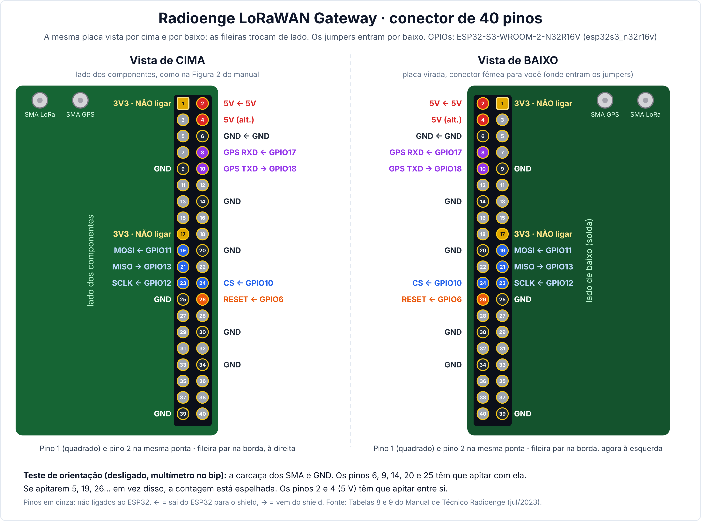</a>
</p>
<p align="center"><sub>🔍 Alta resolução (PNG, 3600 px de largura): clique na imagem para ampliar · versão vetorial: <a href="../images/radioenge_header_cima_baixo_esp32s3_n32r16v.svg"><code>radioenge_header_cima_baixo_esp32s3_n32r16v.svg</code></a></sub></p>

### 2.0 Ligação com cada placa ESP32

Cada placa tem o próprio guia: tabela de ligações, pinout da DevKit, conector de 40 pinos com os GPIOs daquela placa (vista de cima e de baixo), diagrama bloco a bloco, ligação direta no módulo de 14 vias, alimentação, observações e conferência pós-ligação. Os dois S3 usam os mesmos fios; muda só o firmware.

#### ESP32-WROOM-32U DevKit (`esp32`)

<p align="center">
  <a href="../images/wiring_esp32_wroom32u.png">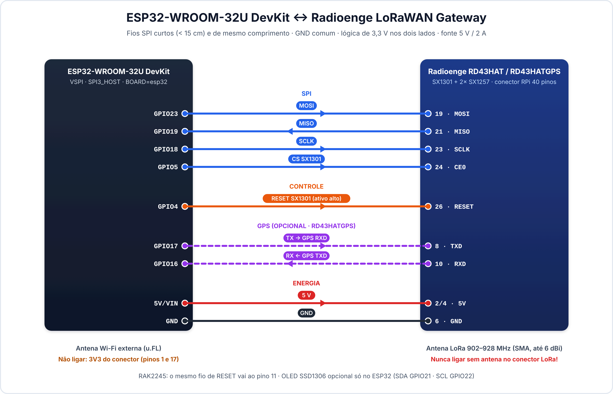</a>
</p>
<p align="center"><sub>🔍 Alta resolução (PNG, 3720 px de largura): clique na imagem para ampliar · versão vetorial: <a href="../images/wiring_esp32_wroom32u.svg"><code>wiring_esp32_wroom32u.svg</code></a></sub></p>

<p align="center">
  <a href="../images/radioenge_header_esp32.png">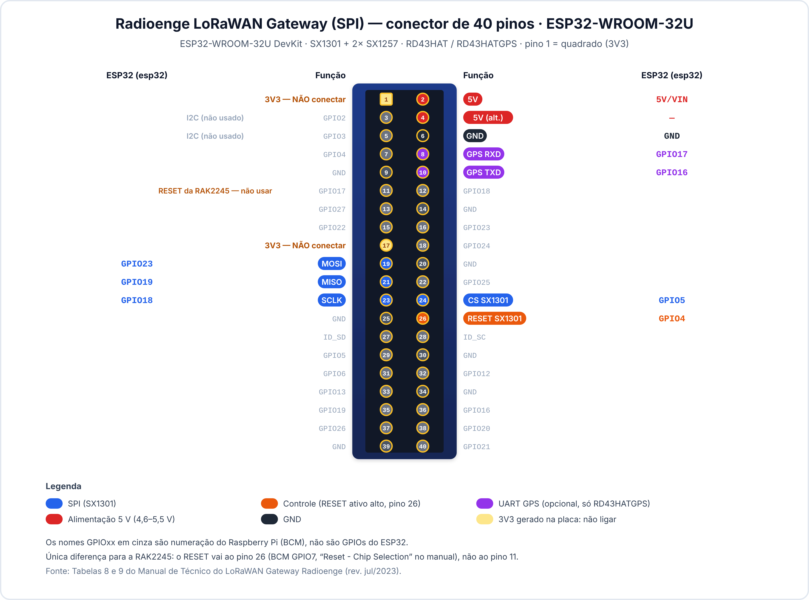</a>
</p>
<p align="center"><sub>🔍 Alta resolução (PNG, 3720 px de largura): clique na imagem para ampliar · versão vetorial: <a href="../images/radioenge_header_esp32.svg"><code>radioenge_header_esp32.svg</code></a></sub></p>

| Pino da Radioenge | 19 | 21 | 23 | 24 | **26** | 8 | 10 | 2/4 | 6 |
|---|:---:|:---:|:---:|:---:|:---:|:---:|:---:|:---:|:---:|
| Sinal | MOSI | MISO | SCLK | CS | **RESET** | GPS RXD | GPS TXD | 5 V | GND |
| GPIO | GPIO23 | GPIO19 | GPIO18 | GPIO5 | **GPIO4** | GPIO17 | GPIO16 | 5V/VIN | GND |

Guia completo: [`ESP32-WROOM-32U_DevKit.md`](ESP32-WROOM-32U_DevKit.md).

#### ESP32-S3-WROOM-1U-N16R8 DevKitC-1 (`esp32s3_n16r8`)

<p align="center">
  <a href="../images/wiring_esp32s3_wroom1u_n16r8.png">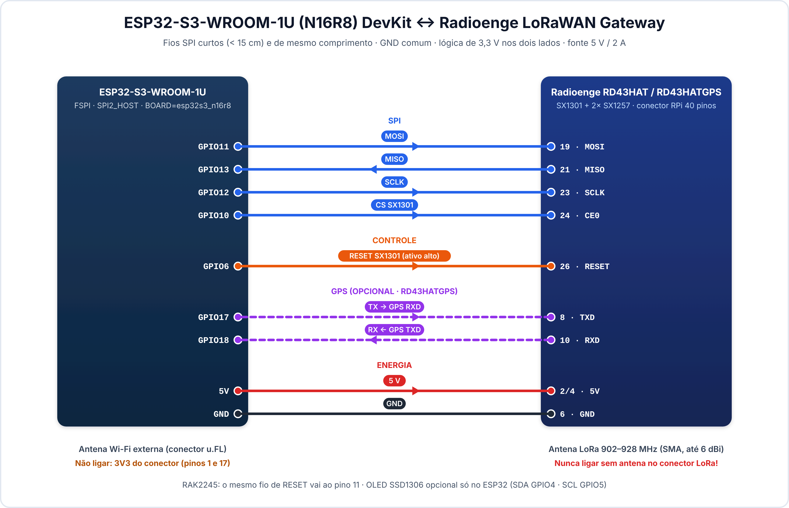</a>
</p>
<p align="center"><sub>🔍 Alta resolução (PNG, 3720 px de largura): clique na imagem para ampliar · versão vetorial: <a href="../images/wiring_esp32s3_wroom1u_n16r8.svg"><code>wiring_esp32s3_wroom1u_n16r8.svg</code></a></sub></p>

<p align="center">
  <a href="../images/radioenge_header_esp32s3_n16r8.png">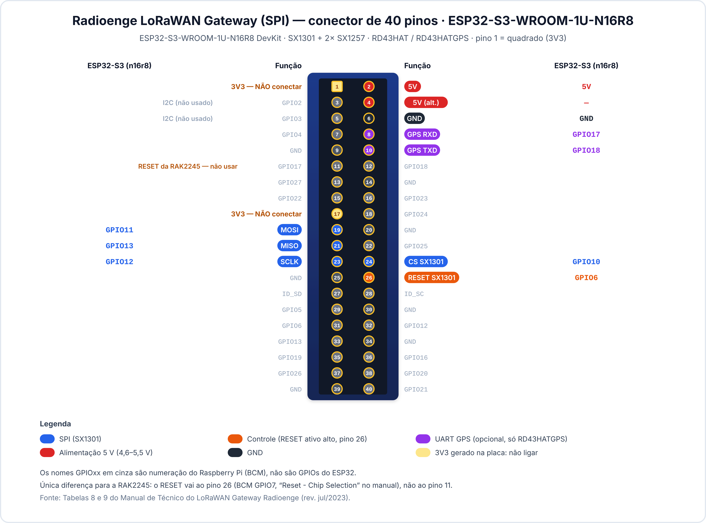</a>
</p>
<p align="center"><sub>🔍 Alta resolução (PNG, 3720 px de largura): clique na imagem para ampliar · versão vetorial: <a href="../images/radioenge_header_esp32s3_n16r8.svg"><code>radioenge_header_esp32s3_n16r8.svg</code></a></sub></p>

| Pino da Radioenge | 19 | 21 | 23 | 24 | **26** | 8 | 10 | 2/4 | 6 |
|---|:---:|:---:|:---:|:---:|:---:|:---:|:---:|:---:|:---:|
| Sinal | MOSI | MISO | SCLK | CS | **RESET** | GPS RXD | GPS TXD | 5 V | GND |
| GPIO | GPIO11 | GPIO13 | GPIO12 | GPIO10 | **GPIO6** | GPIO17 | GPIO18 | 5V | GND |

Guia completo: [`ESP32-S3-WROOM-1U_N16R8_DevKit.md`](ESP32-S3-WROOM-1U_N16R8_DevKit.md).

#### ESP32-S3-WROOM-2-N32R16V DevKitC-1 (`esp32s3_n32r16v`)

<p align="center">
  <a href="../images/wiring_esp32s3_wroom2.png">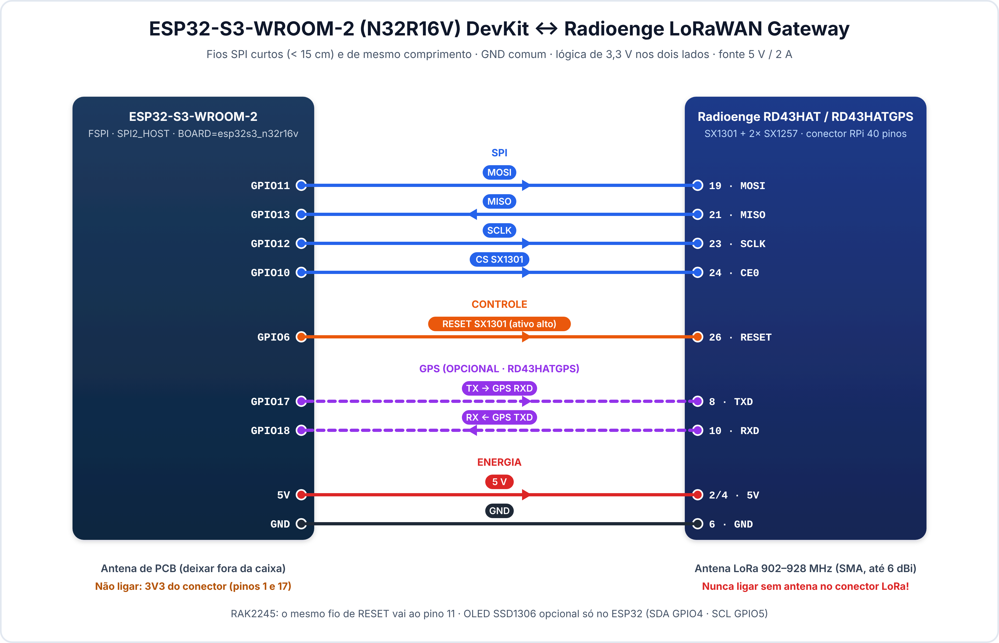</a>
</p>
<p align="center"><sub>🔍 Alta resolução (PNG, 3720 px de largura): clique na imagem para ampliar · versão vetorial: <a href="../images/wiring_esp32s3_wroom2.svg"><code>wiring_esp32s3_wroom2.svg</code></a></sub></p>

<p align="center">
  <a href="../images/radioenge_header_esp32s3_n32r16v.png">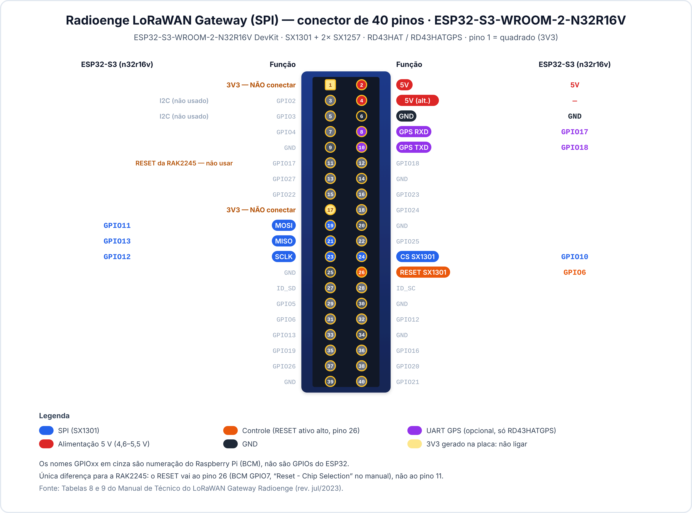</a>
</p>
<p align="center"><sub>🔍 Alta resolução (PNG, 3720 px de largura): clique na imagem para ampliar · versão vetorial: <a href="../images/radioenge_header_esp32s3_n32r16v.svg"><code>radioenge_header_esp32s3_n32r16v.svg</code></a></sub></p>

| Pino da Radioenge | 19 | 21 | 23 | 24 | **26** | 8 | 10 | 2/4 | 6 |
|---|:---:|:---:|:---:|:---:|:---:|:---:|:---:|:---:|:---:|
| Sinal | MOSI | MISO | SCLK | CS | **RESET** | GPS RXD | GPS TXD | 5 V | GND |
| GPIO | GPIO11 | GPIO13 | GPIO12 | GPIO10 | **GPIO6** | GPIO17 | GPIO18 | 5V | GND |

Guia completo: [`ESP32-S3-WROOM-2_N32R16V_DevKit.md`](ESP32-S3-WROOM-2_N32R16V_DevKit.md).

### 2.1 Ligando direto no conector de 14 vias do módulo

Sem o conector de 40 pinos (módulo "LoRaMESH Gateway" GWLORA v1, passo de 2,54 mm, Figura 3 do manual), use a coluna "Pino do módulo" da tabela acima: 1/2 GND, 3/4 +5 V, 5 RESET, 6 SCK, 7 MISO, 8 MOSI, 9 CSN, 13 GPSRXD, 14 GPSTXD. O pino 10 não é ligado (NC).

<p align="center">
  <a href="../images/radioenge/radioenge_fig3_pinout_modulo.png">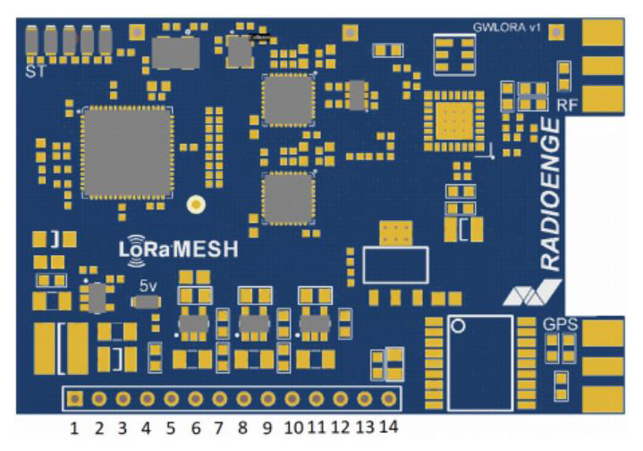</a>
</p>
<p align="center"><sub>Figura 3 do manual: numeração do conector de 14 vias do módulo GWLORA v1 (pinos 1 a 14, da esquerda para a direita).</sub></p>

<p align="center">
  <a href="../images/radioenge_modulo_14vias.png">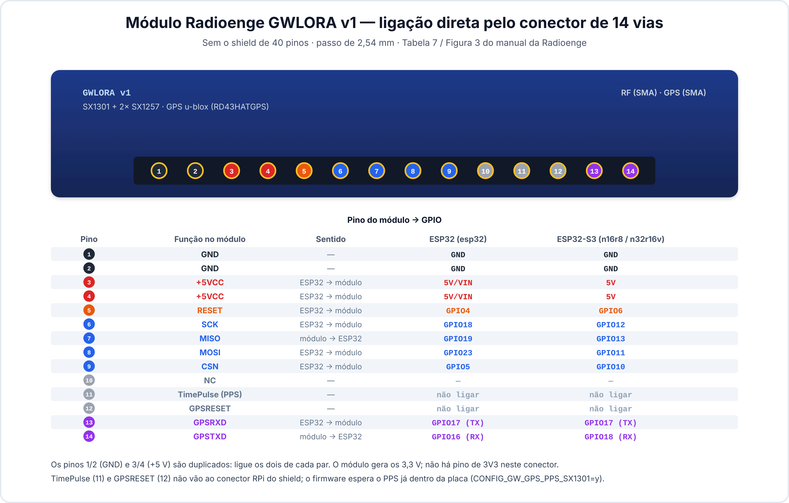</a>
</p>
<p align="center"><sub>🔍 Alta resolução (PNG, 3720 px de largura): clique na imagem para ampliar · versão vetorial: <a href="../images/radioenge_modulo_14vias.svg"><code>radioenge_modulo_14vias.svg</code></a></sub></p>

<p align="center">
  <a href="../images/radioenge/radioenge_fig4_dimensoes_mm.png">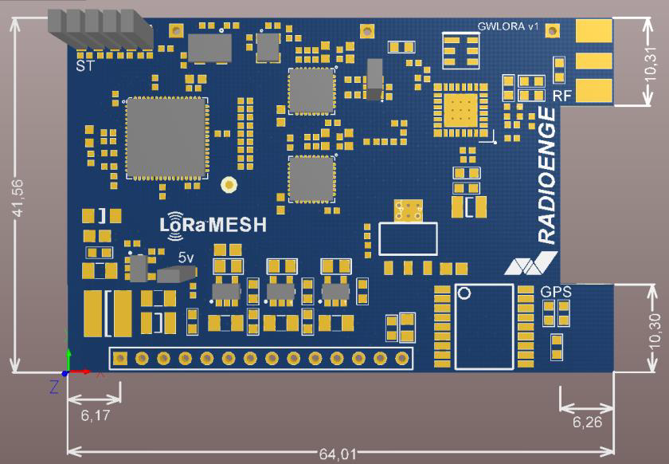</a>
</p>
<p align="center"><sub>Figura 4 do manual: dimensões do módulo em milímetros (64,01 × 41,56 mm). Útil para projetar a placa-mãe ou a caixa do gateway.</sub></p>

---

## 3. Compilar e configurar

Nada muda no build. Use a placa ESP32 que você tem:

```bash
./scripts/build.sh esp32           flash /dev/ttyUSB0
./scripts/build.sh esp32s3_n16r8   flash /dev/ttyACM0
./scripts/build.sh esp32s3_n32r16v flash /dev/ttyACM0
```

Com log em `logs/` e nas variantes **Do zero** (apaga a flash), **Atualizar** (mantém a configuração) e **Só monitorar**: [Gravar e acompanhar o log](../../README.md#gravar-e-acompanhar-o-log) do README, ou a seção de compilação de [ESP32-WROOM-32U](ESP32-WROOM-32U_DevKit.md#9-compilar-e-gravar), [ESP32-S3-WROOM-1U-N16R8](ESP32-S3-WROOM-1U_N16R8_DevKit.md#9-configuração-do-firmware-compilar-e-gravar) e [ESP32-S3-WROOM-2-N32R16V](ESP32-S3-WROOM-2_N32R16V_DevKit.md#9-configuração-do-firmware-compilar-e-gravar).

Na página web (ou no console), escolha o plano **AU915** (o do Brasil): **AU915 SB1** (canais 8–15 + 65, padrão) ou **AU915 SB0** (canais 0–7 + 64), o mesmo *sub-band* do ChirpStack e dos nós. Os planos EU868 e CN470 **não servem** para esta placa (o filtro e o PA são de 915 MHz). O US915 só recebe se os canais caírem em 902,5–907 MHz e não é o plano usado no Brasil.

---

## 4. Alimentação

- A Radioenge consome **300 mA só recebendo** e **700 mA transmitindo** a +27 dBm, mais que a RAK2245 (~500 mA). Com o ESP32 (Wi-Fi com picos de ~350 mA), o conjunto passa de **1 A**.
- **A USB do PC (500 mA) não basta**, nem durante o desenvolvimento: aparecem *brownout* do ESP32 ou reset do SX1301 no meio do TX. Use uma **fonte de 5 V / 2 A** ligada aos pinos 2/4 do conector (ou ao 5V da DevKit), com o **GND comum**.
- Tensão de operação: 4,6 a 5,5 V. Acima de 5,5 V a placa pode ser danificada.

---

## 5. GPS e PPS (RD43HATGPS)

1. Ligue os pinos 8 e 10 e ative o GPS na página web (seção **GPS**) ou no console (`gps on`). O firmware lê NMEA a 9600 baud.
2. A saída **TimePulse** (PPS) do GPS sai no pino 11 do módulo de 14 vias e **não** vai ao conector do Raspberry Pi. O próprio *packet forwarder* da Radioenge no Raspberry Pi só consegue a referência de tempo do GPS se o PPS chegar ao SX1301 dentro da placa, como na RAK2245. Por isso o firmware fica com `CONFIG_GW_GPS_PPS_SX1301=y` (padrão).
3. **Confirme na bancada:** com o GPS com *fix*, a seção GPS da página e o relatório do console devem mostrar `# Valid time reference`. Se a posição aparece mas a referência de tempo nunca fica válida, o PPS não chega ao SX1301 nesta revisão da placa. Nesse caso, compile com `CONFIG_GW_GPS_PPS_SX1301=n` (`idf.py menuconfig` → *ESP32_SX1301 gateway features*): o GPS passa a dar só a posição, e o gateway funciona sem class B e sem horário GPS nos uplinks.
4. Na versão **RD43HAT** (sem GPS), deixe o GPS desligado (padrão).

---

## 6. Primeira ligação: o que conferir

| Conferência | O esperado | Se falhar |
|---|---|---|
| Boot | `INFO: [main] concentrator started, packet can now be received` | o firmware roda o `sx1301_wiring_diag` |
| Versão do chip | `[2] reset active-HIGH ...: chip version 103 (0x67)` | nenhuma combinação lê 103, ou só a "active-LOW": confira se o RESET está no pino **26** (e não no 11, o da RAK2245) |
| CS / MISO | `the SX1301 is answering the chip select` | fio do CS fora do pino 24, ou placa sem 5 V |
| MISO com o chip desligado | `[1] ... CS HIGH (not selected): 1 / 0` | `0 / 0` e versão `v0`: módulo sem 5 V ou fios na fileira trocada; confira a [vista de baixo](#vista-de-cima--vista-de-baixo-confira-antes-de-ligar-os-fios) e o teste do bip |
| Recepção | uplinks dos nós AU915 no log e no ChirpStack | conferir plano/*sub-band*; calibrar `rssi_offset` comparando o RSSI com outro gateway |
| Transmissão | `tx_ok` nas estatísticas, downlinks e *join accept* chegando | conferir a fonte de 5 V e a antena; medir a potência real e ajustar `tx_lut_*` |
| GPS | posição e satélites na página; `# Valid time reference` | seção 5 |

---

## 7. Diferenças em relação à RAK2245 Pi HAT

| | Radioenge LoRaWAN Gateway | RAK2245 Pi HAT |
|---|---|---|
| Concentrador | SX1301 | SX1301 |
| RESET no conector RPi | **pino 26** (BCM 7) | pino 11 (BCM 17) |
| CS | pino 24 (CE0) | pino 24 (CE0) |
| GPS | opcional (RD43HATGPS), UART nos pinos 8/10 | opcional (L76), UART nos pinos 8/10 |
| Consumo no TX | **700 mA** a +27 dBm | ~500 mA |
| Faixa | 902,5–907 e 915–928 MHz | 902–928 MHz (versão 915) |
| Homologação ANATEL | sim (02053-18-07215) | conforme o importador |

---

## Créditos das imagens

- Figuras 1, 2, 3, 4, 6 e 7: Manual de Técnico do LoRaWAN Gateway Radioenge, rev. jul/2023 ([PDF](https://www.radioenge.com.br/wp-content/uploads/2021/08/Manual_LoRaWAN_Gateway_jul_2023.pdf)), em [`doc/images/radioenge/`](../images/radioenge/).
- Foto do shield: `doc/images/radioenge/radioenge_hat_foto.jpg`.
- Diagramas de ligação (SVG + PNG de 3720 px): desenhados para este projeto, em [`doc/images/`](../images/).

Placa adaptadora (a Radioenge encaixa num 2×20 sobre placa perfurada, sem jumpers; esquema, posicionamento e onde soldar cada fio em cada uma das três DevKits) e caixa para impressão 3D: [`hardware_design/`](../../hardware_design/) · [`hardware_design/motherboard/`](../../hardware_design/motherboard/).
