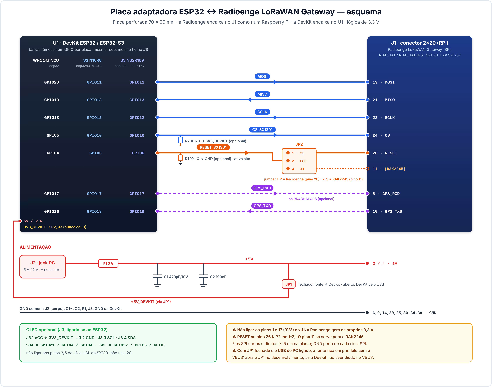
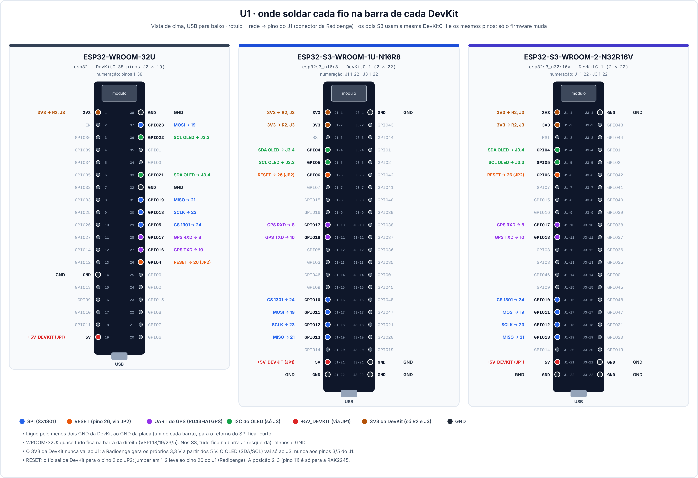
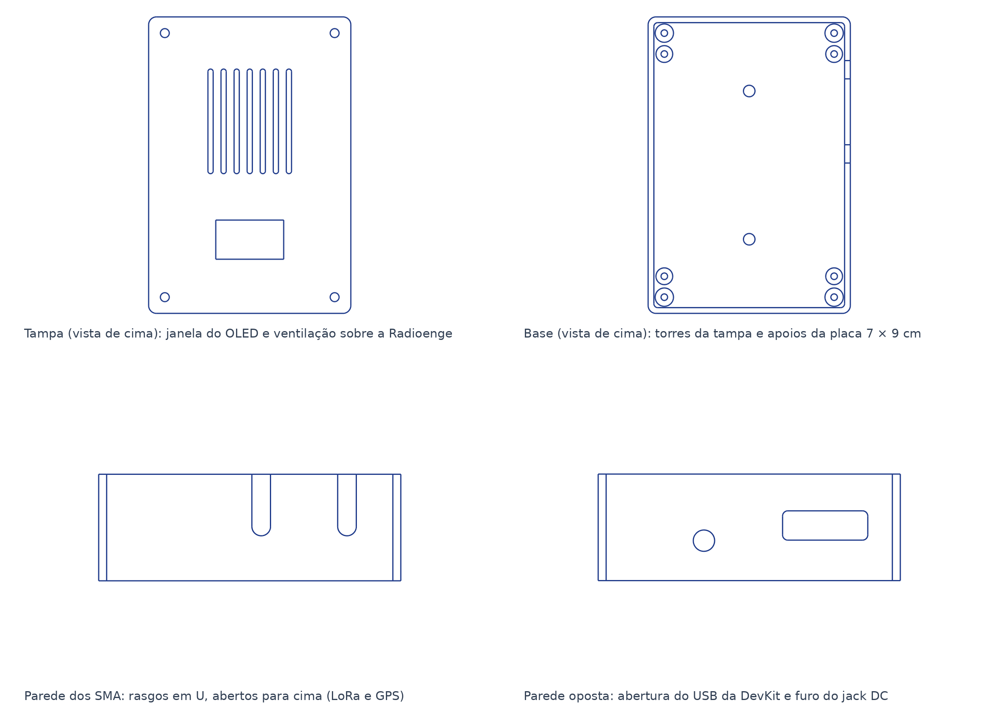

# Hardware Design (ESP32_SX1301)

O hardware do ESP32_SX1301 tem três partes. O concentrador é uma placa pronta (a **Radioenge LoRaWAN Gateway**), e não um módulo para soldar numa placa-mãe:

| Parte | Pasta |
|---|---|
| Concentrador | [`radioenge/`](radioenge/) (placa principal: manual e figuras) + [`sx1301/`](sx1301/) (referência Semtech SX1301AP1CAS, 915 MHz) |
| Placa-mãe | [`motherboard/`](motherboard/): **placa adaptadora em placa perfurada**. A Radioenge encaixa num conector 2×20, como num Raspberry Pi, e a DevKit em barras fêmeas |
| Caixa | [`case/`](case/): **caixa paramétrica** (CadQuery) com STEP, STL e DXF prontos |

A placa adaptadora serve para as **três placas** do projeto (ESP32-WROOM-32U, ESP32-S3-WROOM-1U-N16R8 e ESP32-S3-WROOM-2-N32R16V), com os mesmos fios até o J1. Só muda o pino da DevKit em que cada fio é soldado.

```
hardware_design/
├── README.md                     # este arquivo
├── radioenge/
│   ├── README.md                 # resumo da placa e onde estão as figuras
│   └── Manual_LoRaWAN_Gateway_jul_2023.pdf
├── sx1301/
│   └── README.md                 # projeto de referência da Semtech e parâmetros que dependem da placa
├── motherboard/
│   ├── README.md                 # montagem passo a passo
│   ├── esp32_radioenge_adapter_schematic.svg / .png
│   ├── esp32_radioenge_adapter_layout.svg / .png
│   ├── esp32_radioenge_adapter_devkit_pins.svg / .png   # onde soldar cada fio nas três DevKits
│   ├── esp32_radioenge_adapter_netlist.csv
│   ├── esp32_radioenge_adapter_bom.csv
│   └── gen_adapter.py, gen_layout.py, gen_devkit_map.py   # geradores (edite e rode de novo)
└── case/
    ├── README.md                 # impressão, parâmetros e o que conferir
    ├── case_sx1301.py            # modelo paramétrico (CadQuery)
    ├── esp32_sx1301_bottom_case.step / .stl
    ├── esp32_sx1301_top_case.step / .stl / .dxf
    └── case_views.png
```

> **A placa adaptadora e a caixa são opcionais.** O gateway funciona com a DevKit ligada à Radioenge por 9 jumpers curtos, como nos guias de [`doc/hardware/`](../doc/hardware/). A placa adaptadora e a caixa servem para uma instalação fixa: sem jumpers soltos e com a fonte de 5 V / 2 A num jack próprio.

---

## 1. Concentrador

- **Radioenge LoRaWAN Gateway (RD43HAT / RD43HATGPS):** placa pronta, homologada pela ANATEL. Não há nada para fabricar. O manual técnico (rev. jul/2023) fica em [`radioenge/`](radioenge/), e o guia de uso com o ESP32 está em [`doc/hardware/Radioenge_LoRaWAN_Gateway.md`](../doc/hardware/Radioenge_LoRaWAN_Gateway.md).
- **Projeto de referência da Semtech:** a Radioenge, a RAK2245, a RAK831 e a iC880A seguem a placa de demonstração **SX1301AP1CAS (915 MHz, revisão e286V02b)**. Os valores padrão de `clksrc`, `rssi_offset`, `tx_notch_freq` e `tx_lut_*` dos JSON vêm desse projeto. Detalhes e onde baixar: [`sx1301/README.md`](sx1301/README.md).

## 2. Placa adaptadora

<p align="center">
  <a href="motherboard/esp32_radioenge_adapter_schematic.png"></a>
</p>

Ela tem só conectores e passivos:
- **J1**: 2×20 macho, onde a Radioenge encaixa.
- **U1**: barras fêmeas para a DevKit (ESP32-WROOM-32U DevKitC ou ESP32-S3-DevKitC-1, N16R8 ou N32R16V).
- **J2**: jack DC de 5 V, com **F1** (PTC) e **C1/C2** para os picos de 700 mA do TX.
- **JP1**: escolhe se a fonte também alimenta a DevKit.
- **JP2**: escolhe o pino do RESET, 26 na Radioenge ou 11 na RAK2245.
- **J3**: OLED opcional.

Onde soldar cada fio na barra de cada DevKit:

<p align="center">
  <a href="motherboard/esp32_radioenge_adapter_devkit_pins.png"></a>
</p>

Passo a passo: [`motherboard/README.md`](motherboard/README.md).

## 3. Caixa

<p align="center">
  <a href="case/case_views.png"></a>
</p>

Caixa de 77,4 × 113,4 × 42,2 mm em duas peças (base e tampa) para a placa perfurada de 7 × 9 cm com a Radioenge empilhada. Tem rasgos em U para os dois SMA, abertura para o USB, furo para o jack DC, janela para o OLED e ventilação sobre a Radioenge. **As medidas do shield vêm do padrão Raspberry Pi HAT e de fotos: confira com paquímetro** antes de imprimir ([`case/README.md`](case/README.md)).
