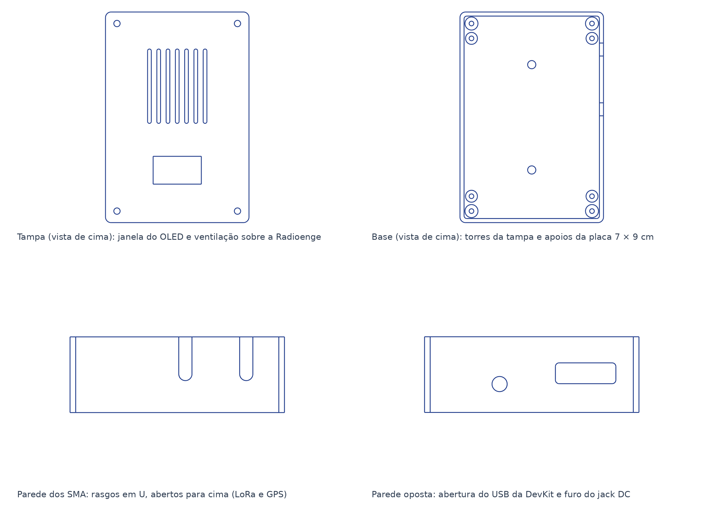

# Caixa do ESP32_SX1301

Caixa em duas peças (base e tampa) para a [placa adaptadora](../motherboard/): placa perfurada de 70 × 90 mm com a Radioenge empilhada a 11 mm e a DevKit ao lado.

  

| Arquivo | Uso |
|---|---|
| `esp32_sx1301_bottom_case.stl` / `.step` | base: imprimir de boca para cima |
| `esp32_sx1301_top_case.stl` / `.step` | tampa: imprimir com a face lisa na mesa (a aba para cima) |
| `esp32_sx1301_top_case.dxf` | contorno da tampa para corte a laser (acrílico de 2–3 mm, transparente) |
| `case_sx1301.py` | modelo paramétrico em [CadQuery](https://cadquery.readthedocs.io/): `pip install cadquery && python3 case_sx1301.py` gera de novo os arquivos acima |

O `.step` abre no FreeCAD (Arquivo → Importar) e em qualquer CAD.

## Medidas

| Item | Valor |
|---|---|
| Externa | 77,4 × 113,4 × 42,2 mm (base 40 mm + tampa 2,2 mm) |
| Paredes / fundo | 2,2 / 2,0 mm |
| Placa perfurada | 70 × 90 mm em 4 apoios de 5 mm (M3 autoatarraxante) |
| Tampa | 4 parafusos M3 nas torres dos cantos (furo-piloto de 2,5 mm; use 4,0 mm se for colocar insertos) |
| SMA LoRa / GPS | rasgos em U de 7 mm, abertos para cima, centro a 20,4 mm do fundo |
| USB da DevKit | abertura de 32 × 11 mm (cabe os 2 USB-C da S3-DevKitC-1) |
| Jack DC | furo de 8 mm (jack 5,5 × 2,1 de painel) |
| Tampa | janela de 26 × 15 mm para o OLED 0,96" e 7 rasgos de ventilação sobre a Radioenge |

## Conferir antes de imprimir

As medidas abaixo **não** estão no manual da Radioenge; vêm do padrão Raspberry Pi HAT e de fotos. Meça a sua placa e ajuste no topo do `case_sx1301.py`:

| Parâmetro | Valor atual | O que medir |
|---|---|---|
| `HAT_X`, `HAT_Y` | 65 × 56,5 mm | contorno do shield |
| `SMA_Y` | 81,5 e 49,3 mm | posição dos dois SMA ao longo da borda (a partir da borda da placa perfurada do lado da DevKit) |
| `HAT_STACK` | 11 mm | altura do espaçador entre a placa perfurada e o shield |
| `PERF_HOLE_INSET` | 2,5 mm | centro dos furos de canto da sua placa perfurada |
| `USB_Y`, `DC_Y` | 16,5 e 62 mm | centro do USB da DevKit e do jack DC |

Dicas:
- Imprima em **PETG** ou ASA se o gateway ficar em local quente: a Radioenge opera até +55 °C.
- No WROOM-32U e no **ESP32-S3-WROOM-1U (N16R8)**, use uma antena u.FL com passa-muro na parede. A antena de PCB do **ESP32-S3-WROOM-2 (N32R16V)** funciona através do plástico, mas deixe a ponta do módulo longe de metal.
- **Nunca** ligue a Radioenge sem antena no SMA LoRa.
