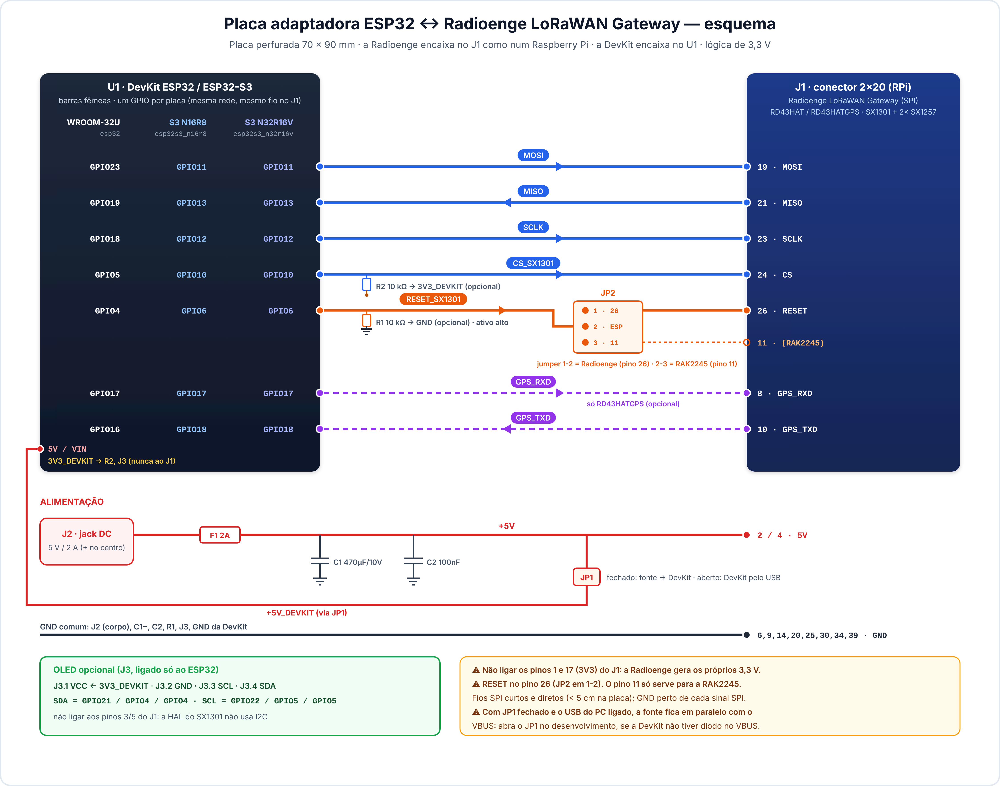
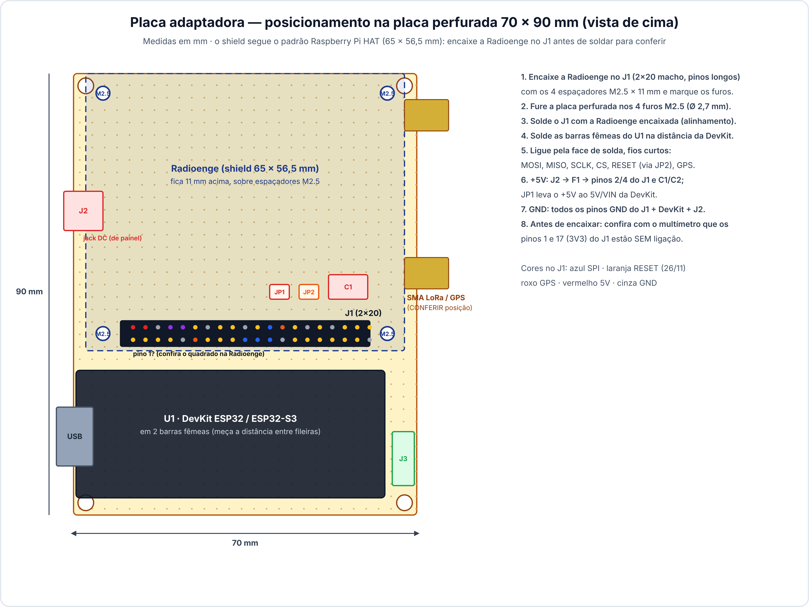

# Placa adaptadora ESP32 ↔ Radioenge (placa perfurada 70 × 90 mm)

A placa adaptadora dispensa PCB de fábrica: é montada numa placa perfurada (ilhada) comum de 7 × 9 cm. A **Radioenge encaixa no J1 como num Raspberry Pi**, e a **DevKit encaixa em barras fêmeas**. Os fios ficam curtos na face de solda, e a fonte de 5 V / 2 A entra por um jack próprio.

Serve para as três placas do projeto. Os fios até o J1 são os mesmos; só muda o pino da DevKit em que cada fio é soldado (colunas `esp32`, `esp32s3_n16r8` e `esp32s3_n32r16v` da netlist).

<p align="center">
  <a href="esp32_radioenge_adapter_schematic.png"></a>
</p>
<p align="center"><sub>🔍 Alta resolução (PNG): clique para ampliar · vetorial: <a href="esp32_radioenge_adapter_schematic.svg"><code>esp32_radioenge_adapter_schematic.svg</code></a></sub></p>

<p align="center">
  <a href="esp32_radioenge_adapter_layout.png"></a>
</p>
<p align="center"><sub>🔍 Alta resolução (PNG): clique para ampliar · vetorial: <a href="esp32_radioenge_adapter_layout.svg"><code>esp32_radioenge_adapter_layout.svg</code></a></sub></p>

<p align=\"center\">
  <a href=\"esp32_radioenge_adapter_devkit_pins.png\"></a>
</p>
<p align=\"center\"><sub>🔍 Alta resolução (PNG): clique para ampliar · vetorial: <a href=\"esp32_radioenge_adapter_devkit_pins.svg\"><code>esp32_radioenge_adapter_devkit_pins.svg</code></a></sub></p>

## Arquivos

| Arquivo | Conteúdo |
|---|---|
| [`esp32_radioenge_adapter_schematic.svg`](esp32_radioenge_adapter_schematic.svg) / `.png` | esquema |
| [`esp32_radioenge_adapter_layout.svg`](esp32_radioenge_adapter_layout.svg) / `.png` | posição dos componentes na placa perfurada |
| [`esp32_radioenge_adapter_devkit_pins.svg`](esp32_radioenge_adapter_devkit_pins.svg) / `.png` | onde soldar cada fio na barra de cada uma das três DevKits |
| [`esp32_radioenge_adapter_netlist.csv`](esp32_radioenge_adapter_netlist.csv) | ligação a ligação: rede, pino do J1, GPIO de cada placa |
| [`esp32_radioenge_adapter_bom.csv`](esp32_radioenge_adapter_bom.csv) | lista de materiais |
| `gen_adapter.py`, `gen_layout.py`, `gen_devkit_map.py` | geradores dos arquivos acima |

Para gerar de novo (por exemplo, depois de mudar um pino em `main/CMakeLists.txt` e na tabela `NETS` de `gen_adapter.py`):

```bash
cd hardware_design/motherboard
python3 gen_adapter.py && python3 gen_layout.py && python3 gen_devkit_map.py
for f in esp32_radioenge_adapter_*.svg; do rsvg-convert -w 3800 "$f" -o "${f%.svg}.png"; done
```

## Ligações

A pinagem é a de [`main/CMakeLists.txt`](../../main/CMakeLists.txt), a mesma dos guias de [`doc/hardware/`](../../doc/hardware/). Os pinos do J1 seguem as tabelas 8 e 9 do [manual da Radioenge](../radioenge/Manual_LoRaWAN_Gateway_jul_2023.pdf).

| Rede | J1 (pino RPi) | `esp32` (WROOM-32U) | `esp32s3_n16r8` (WROOM-1U) | `esp32s3_n32r16v` (WROOM-2) |
|---|:---:|:---:|:---:|:---:|
| MOSI | 19 | GPIO23 · pino 37 | GPIO11 · J1-17 | GPIO11 · J1-17 |
| MISO | 21 | GPIO19 · pino 31 | GPIO13 · J1-19 | GPIO13 · J1-19 |
| SCLK | 23 | GPIO18 · pino 30 | GPIO12 · J1-18 | GPIO12 · J1-18 |
| CS do SX1301 | 24 | GPIO5 · pino 29 | GPIO10 · J1-16 | GPIO10 · J1-16 |
| RESET do SX1301 (ativo alto) | **26** pelo JP2 (1-2) · 11 na RAK2245 (2-3) | GPIO4 · pino 26 | GPIO6 · J1-6 | GPIO6 · J1-6 |
| GPS RXD ← TX do ESP32 *(RD43HATGPS)* | 8 | GPIO17 · pino 28 | GPIO17 · J1-10 | GPIO17 · J1-10 |
| GPS TXD → RX do ESP32 *(RD43HATGPS)* | 10 | GPIO16 · pino 27 | GPIO18 · J1-11 | GPIO18 · J1-11 |
| +5V | 2, 4 | 5V · pino 19, pelo JP1 | 5V · J1-21, pelo JP1 | 5V · J1-21, pelo JP1 |
| GND | 6, 9, 14, 20, 25, 30, 34, 39 | GND · pinos 14, 32, 38 | GND · J1-22, J3-1, J3-21, J3-22 | GND · J1-22, J3-1, J3-21, J3-22 |
| OLED SDA / SCL (só J3) | — (não ligar aos pinos 3/5) | GPIO21 · pino 33 / GPIO22 · pino 36 | GPIO4 · J1-4 / GPIO5 · J1-5 | GPIO4 · J1-4 / GPIO5 · J1-5 |
| 3V3 da DevKit → R2, J3 | — | 3V3 · pino 1 | 3V3 · J1-1 / J1-2 | 3V3 · J1-1 / J1-2 |
| **3V3 do J1 (pinos 1 e 17)** | **não ligar** | — | — | — |

Numeração dos pinos da DevKit igual à das figuras de pinagem do projeto (vista de cima, USB para baixo): no WROOM-32U, 1–19 na barra da esquerda (de cima para baixo) e 38–20 na da direita; nos S3, J1-1 a J1-22 à esquerda e J3-1 a J3-22 à direita.

> **Os dois S3 usam a mesma DevKitC-1 e os mesmos pinos.** A placa adaptadora é a mesma para o N16R8 e o N32R16V; só o firmware muda (`esp32s3_n16r8` ou `esp32s3_n32r16v`). Confira a marcação do módulo antes de gravar ([`doc/hardware/README.md`](../../doc/hardware/README.md)).

## Montagem

1. **Encaixe a Radioenge no J1** (barra 2×20 macho de pinos longos, ainda solta) e prenda com os 4 espaçadores M2.5 × 11 mm. Apoie o conjunto na placa perfurada, na posição do desenho, e marque os 4 furos.
2. **Fure** os 4 pontos com broca de 2,7 mm. Os furos da placa perfurada não caem na grade dos furos M2.5 do padrão HAT (58 × 49 mm).
3. **Solde o J1 com a Radioenge encaixada**, para o alinhamento ficar certo. O pino 1 do J1 é o que fica embaixo do pino 1 da Radioenge (quadrado, "3V3"). Depois tire a Radioenge.
4. **Solde as barras fêmeas do U1** na distância entre fileiras da sua DevKit. Meça com a DevKit encaixada nas barras: ESP32-WROOM-32U DevKitC tem 2 × 19 pinos, e ESP32-S3-DevKitC-1 tem 2 × 22. O USB fica virado para a borda da placa.
5. **Ligue os sinais** pela face de solda, com fio rígido AWG 26–28, o mais curto possível: MOSI, MISO, SCLK, CS, RESET (até o pino central do JP2) e GPS. Use a coluna da sua placa na tabela acima ou a figura `esp32_radioenge_adapter_devkit_pins.png`.
6. **Alimentação:** jack DC (J2, de painel, fixado na caixa) → F1 → pinos 2 e 4 do J1. Ponha C1 (470 µF) deitado e C2 (100 nF) junto do J1. O JP1 leva o +5V ao 5V/VIN da DevKit.
7. **GND:** ligue todos os pinos GND do J1, pelo menos dois GND da DevKit (um de cada barra), o corpo do J2, C1, C2, R1 e J3.
8. **Antes de encaixar as placas**, confira com o multímetro:
   - os pinos 1 e 17 do J1 sem ligação com nada;
   - nenhum curto entre +5V e GND;
   - continuidade de cada sinal da tabela.

## Jumpers

| Jumper | Posição | Efeito |
|---|---|---|
| JP1 | fechado | a fonte de 5 V alimenta a Radioenge **e** a DevKit (uso fixo, sem o USB do PC) |
| JP1 | aberto | a DevKit é alimentada pelo USB do PC, e a Radioenge pela fonte (desenvolvimento). O GND continua comum |
| JP2 | 1-2 | RESET no pino **26**: Radioenge |
| JP2 | 2-3 | RESET no pino 11: RAK2245 Pi HAT |

> ⚠️ Com o **JP1 fechado e o USB do PC ligado**, a fonte de 5 V fica em paralelo com o VBUS do PC. Isso só é seguro se a sua DevKit tiver diodo entre o USB e o pino 5V (confira no esquema dela). Na dúvida, abra o JP1 sempre que ligar o USB.

## Opcionais

- **R1 (10 kΩ do RESET ao GND):** mantém o SX1301 fora de reset enquanto o ESP32 inicia e os GPIOs ainda estão flutuando. O firmware gera o pulso de reset sozinho (`lgw_reset()`).
- **R2 (10 kΩ do CS ao 3V3 da DevKit):** mantém o CS em nível alto no boot.
- **J3 (OLED SSD1306):** alimentado pelo 3V3 da DevKit, nunca pelos pinos 1/17 do J1.
