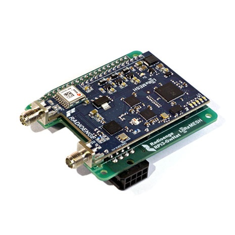

# Radioenge LoRaWAN Gateway: documentação do fabricante

  

- [`Manual_LoRaWAN_Gateway_jul_2023.pdf`](Manual_LoRaWAN_Gateway_jul_2023.pdf): Manual de Técnico da Radioenge, revisão de julho de 2023 (11 páginas). Fonte original: <https://www.radioenge.com.br/wp-content/uploads/2021/08/Manual_LoRaWAN_Gateway_jul_2023.pdf>.
- As figuras do manual usadas na documentação ficam em [`doc/images/radioenge/`](../../doc/images/radioenge/):

| Figura do manual | Arquivo | Conteúdo |
|:---:|---|---|
| 1 | `radioenge_fig1_topologia.png` | Topologia da rede LoRaWAN |
| 2 | `radioenge_fig2_vista_superior.jpg` | Vista superior do shield |
| 3 | `radioenge_fig3_pinout_modulo.png` | Numeração do conector de 14 vias do módulo GWLORA v1 |
| 4 | `radioenge_fig4_dimensoes_mm.png` | Dimensões do módulo (64,01 × 41,56 mm) |
| 6 | `radioenge_fig6_shield.jpg` | O gateway como a Radioenge fornece |
| 7 | `radioenge_fig7_shield_rpi3.jpg` | O gateway acoplado ao Raspberry Pi 3 |

## Dados que importam para o hardware deste projeto

| Item | Valor (manual) | Usado em |
|---|---|---|
| Alimentação | 5 V (4,6–5,5 V); 300 mA recebendo, 700 mA transmitindo | J2/F1/C1 da [placa adaptadora](../motherboard/) |
| Interface | SPI 3,3 V (SX1301) + UART 3,3 V (GPS) | U1 ↔ J1 sem conversor de nível |
| RESET | pino 26 do conector RPi ("Reset - Chip Selection") | JP2 na posição 1-2 |
| Conector | 2×20 fêmea no padrão Raspberry Pi | J1 (2×20 macho, pinos longos) |
| Módulo | GWLORA v1, 64,01 × 41,56 mm, conector de 14 vias (2,54 mm) | ligação direta: [`doc/images/radioenge_modulo_14vias.png`](../../doc/images/radioenge_modulo_14vias.png) |
| Antena | 902–928 MHz, SMA-macho, até 6 dBi | rasgos em U da [caixa](../case/) |
| Temperatura de operação | −5 °C a +55 °C | ventilação da tampa |

Guia completo da placa com o ESP32: [`doc/hardware/Radioenge_LoRaWAN_Gateway.md`](../../doc/hardware/Radioenge_LoRaWAN_Gateway.md).
